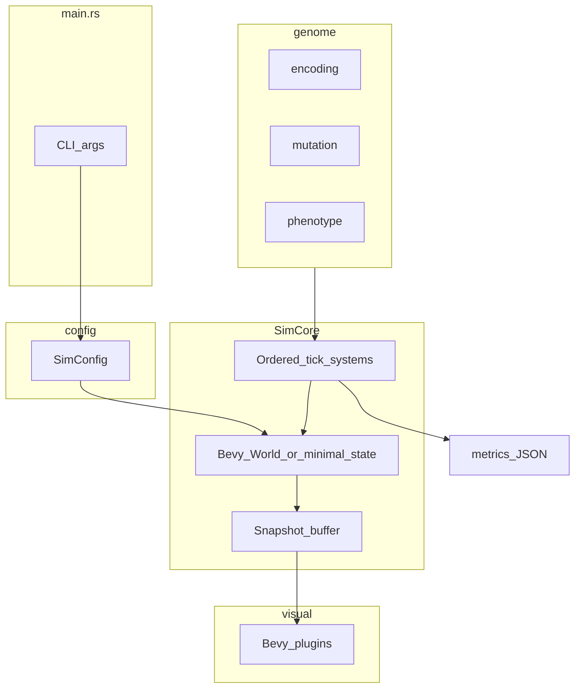

# Architecture

This document describes the target Rust crate layout, separation between `SimCore` and the Bevy visual layer, data flow, and headless metrics.

## High-level data flow



## Crate layout (target)

```
src/
  main.rs              # CLI: --headless, --config, parse args
  lib.rs               # pub mod config, genome, sim, visual
  config.rs            # SimConfig deserialize from TOML
  genome/
    mod.rs
    encoding.rs        # v1 layout, magic, offsets, decode
    mutation.rs        # bit flip, point noise, resample, dup/del
    phenotype.rs       # Phenotype struct, derived traits, upkeeps
  sim/
    mod.rs
    world.rs           # Resources: tick, solar pool, light sampler
    systems/
      mod.rs
      environment.rs
      sense.rs
      metabolism.rs
      movement.rs
      interaction.rs
      healing.rs
      reproduction.rs
      death.rs
      failsafe.rs
    metrics.rs         # Snapshot aggregation, JSON export
    snapshot.rs        # Read-only copy for renderer
  visual/
    mod.rs             # VisualPlugin, sync sprites, debug overlays
```

### Module responsibilities

| Module | Responsibility |
|--------|----------------|
| `config` | Load and validate `SimConfig`; expose constants for decode ranges |
| `genome::encoding` | Byte layout, locus offsets, ancestor template |
| `genome::mutation` | RNG-driven operators on `Genome` |
| `genome::phenotype` | `decode(genome) -> Phenotype`, upkeep helpers |
| `sim::world` | `WorldBounds`, `AvailableSolarEnergy`, light grid, tick counter |
| `sim::systems::*` | One file per pipeline stage; registered in order |
| `sim::metrics` | Periodic JSON/JSONL write |
| `sim::snapshot` | Flat list of renderable entity state |
| `visual` | Bevy app wiring, mesh/material from snapshot |

## SimCore vs Bevy visual

### SimCore

- Owns simulation truth: entities, genomes, energy, health, environment resources.
- Advances with fixed `Δt` in headless mode for `max_ticks`.
- Can run inside a Bevy `App` using `MinimalPlugins` + sim systems only (no window).

### Visual layer

- Adds `DefaultPlugins` (window, render) + `VisualPlugin`.
- Each frame (or every *k* sim ticks): copy `Snapshot` → update `Mesh2d`, `Transform`, optional debug gizmos.
- **Must not** run metabolism, reproduction, or mutation in render-only systems.

### PoC migration (from Phase 0)

Current [`src/main.rs`](../src/main.rs) monolith moves incrementally:

| PoC code | Target |
|---------|--------|
| `Agent`, `Velocity`, movement, bounds | `sim::systems::movement` + `visual` |
| Collision despawn | **Removed**; `sim::systems::interactions` applies collision damage, `death` despawns on `core_hp <= 0` |
| Random colors | `genome` color loci + phenotype decode |
| `WorldBounds` | `sim::world` |

## System registration

Register systems as a chained set in [SIMULATION.md](SIMULATION.md) order:

```rust
// Conceptual
app.add_systems(Update, (
    environment_tick,
    sense_exposure,
    metabolism_and_gains,
    behavior_movement,
    interactions,
    healing,
    reproduction,
    advance_age,
    death_and_despawn,
    performance_failsafe,
    metrics_sample,
).chain());
```

Headless app: no `visual` systems. Visual app: add `sync_snapshot_to_sprites` after sim chain (or on `PostUpdate`).

## RNG architecture

```text
master_seed (optional)
  └─ stream_spawn
  └─ stream_mutation(entity_id, generation)
  └─ stream_repro_risk(entity_id, tick)
```

Use separate streams so debugging one category does not advance others.

## Snapshot struct (visual)

```rust
// Conceptual — fields for renderer
struct EntitySnapshot {
    id: u64,
    position: Vec2,
    radius: f32,
    color: [f32; 4],
    // Debug optional:
    internal_energy: f32,
    core_hp_frac: f32,
}
```

Built at end of tick (or before render) from queries; `Vec<EntitySnapshot>` in resource `RenderSnapshot`.

## Metrics (headless)

Written every `snapshot_interval` ticks to `metrics_path` as **JSONL** (one JSON object per line). Full schema: [PHASE_3.md — JSONL schema](PHASE_3.md#jsonl-schema-frozen-for-phase-3).

### Per-snapshot fields (summary)

| Field | Type | Description |
|-------|------|-------------|
| `tick` | u64 | Current tick |
| `population` | u32 | Living entities |
| `births`, `deaths` | u32 | Since last snapshot |
| `deaths_energy_depleted`, `deaths_core_destroyed`, `deaths_repro_fatality`, `deaths_age_exceeded` | u32 | Death sub-counts (sum to `deaths`) |
| `mean_energy`, `median_energy` | f32 | Population stats (4 decimal places in file) |
| `mean_photo_strength` | f32 | From phenotypes |
| `mean_age_metabolism_scale`, `min_age_metabolism_scale`, `max_age_metabolism_scale` | f32 | Decoded age-metabolism gene spread |
| `color_bins`, `radius_bins` | object | Coarse diversity histograms |
| `genotype_hash_histogram` | object | Optional coarse diversity proxy |
| `mean_skin_hardness`, `mean_core_hp_frac`, `repair_energy_spent`, `mean_greenness` | f32 | Phase 4 aggregates (4 dp) |

### Example JSONL line

```json
{"tick":3600,"population":142,"births":8,"deaths":5,"deaths_energy_depleted":2,"deaths_core_destroyed":1,"deaths_repro_fatality":2,"deaths_age_exceeded":0,"mean_energy":24.5,"median_energy":21.0,"mean_photo_strength":0.42,"mean_age_metabolism_scale":1.1,"min_age_metabolism_scale":0.5,"max_age_metabolism_scale":2.0,"color_bins":{"136,204,68":40},"radius_bins":{"12":142},"mean_skin_hardness":0.12,"mean_core_hp_frac":0.95,"repair_energy_spent":3.2,"mean_greenness":0.72}
```

## CLI (implemented — Phase 3)

```text
evolution_sim [--config PATH] [--headless] [--seed U64]

--config   Path to TOML (default: configs/default.toml)
--headless Run without window; use run.max_ticks (must be > 0)
--seed     Override master_seed in config after load
```

Visual: `cargo run -- --config configs/default.toml`. Headless: add `--headless`. Shared bootstrap: [`sim/app.rs`](../src/sim/app.rs) `build_sim_app` + `run_headless_bevy` (tests).

## Testing strategy (documentation only)

| Layer | Approach |
|-------|----------|
| `genome` | Unit tests: decode known bytes, mutation preserves version |
| `phenotype` | Unit tests: tradeoff formulas bounded |
| `sim` | Headless 1000-tick runs; assert population > 0 and energy finite |
| `visual` | Manual; optional screenshot tests later |

## Dependencies

Current [`Cargo.toml`](../Cargo.toml): `bevy 0.15`, `rand 0.8`, `serde`, `toml`.

Phase 3 additions:

| Crate | Purpose |
|-------|---------|
| `clap` | CLI (`--headless`, `--config`, `--seed`) |
| `serde_json` | Metrics JSONL export |

## Further reading

- [SIMULATION.md](SIMULATION.md) — Config sections and tick order
- [ROADMAP.md](ROADMAP.md) — Which modules land in which phase
- [VISION.md](VISION.md) — Dual runtime goal
