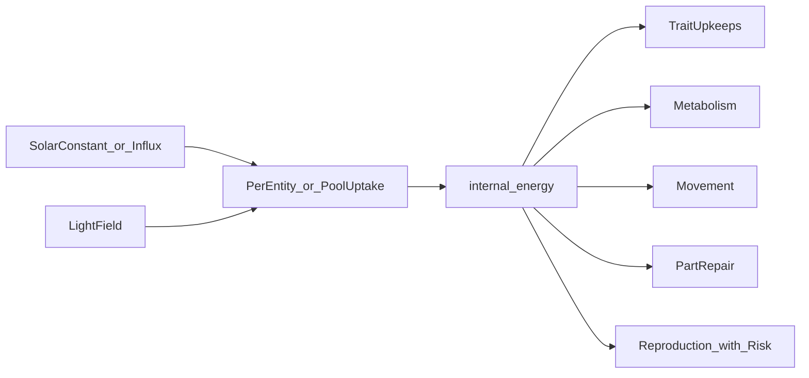

# Energy and Environment

This document describes configurable energy models, per-entity energy and health economics, the light field, thermal vents, hazards, and soup compounds.

**Phase 2 status:** Model **A** (`energy_model = "local"`) and light modes `uniform` / `gradient_y` are implemented in [`src/sim/light.rs`](../src/sim/light.rs), [`src/sim/systems/sense.rs`](../src/sim/systems/sense.rs), and [`src/sim/systems/metabolism.rs`](../src/sim/systems/metabolism.rs). Default config: [`configs/default.toml`](../configs/default.toml). Checklist: [PHASE_2.md](PHASE_2.md). Models **B** (pool) and **C** (spatial occlusion) remain Phase 6.

## Design problem: per-entity vs global energy

**Per-entity irradiance** (`gain = photo_strength * light(pos) * solar_constant`) is simple and valid for early development. The failure mode is **runaway total influx**: if every organism independently harvests the sun, total energy entering the world scales with population, weakening selection toward “always reproduce.”

**Global pool** fixes world-level influx but requires competition rules so one agent cannot drain the planet.

**Spatial shading** reduces local light under crowding (canopy effect) without a global pool.

**Recommendation:** implement model **A** first; add tradeoffs (`photo_upkeep`, metabolism) so model A still self-limits; add **C** when uniform light collapses diversity; add **B** only if runs still cheat thermodynamics.

## Energy models

| Model | Config | Behavior | Best for |
|-------|--------|----------|----------|
| **A. Local** | `energy_model = "local"` | `gain_i = photo_strength_i * light(pos_i) * solar_constant`; world influx **independent** of population | **Implemented** (Phase 2 default) |
| **B. Pool** | `energy_model = "pool"` | `AvailableSolarEnergy += solar_influx * Δt` (capped); entities compete for share in spatial cell | Explicit scarcity, density-dependent selection |
| **C. Spatial** | `energy_model = "spatial"` | Extends A or B: `light(pos)` reduced by local crowding / occlusion | Niche diversity via position |

### Model A — per-entity irradiance

```text
gain = photo_strength * light(pos) * solar_constant
cost = photo_upkeep + metabolism_base + trait_upkeeps
Δinternal_energy = gain - cost   // per tick, before movement/repair/repro
```

`solar_constant` is fixed world parameter; does not multiply by population.

### Model B — global pool + competition

Resource `AvailableSolarEnergy` (f32):

```text
AvailableSolarEnergy = min(solar_cap, AvailableSolarEnergy + solar_influx * Δt)
```

Per entity *i* in spatial cell *c*:

```text
competition_weight_i = photo_strength_i * light(pos_i)
share_i = competition_weight_i / sum_j(competition_weight_j)   // j in cell c
gain_i = share_i * uptake_rate * AvailableSolarEnergy
```

Deduct aggregated uptake from pool after all entities processed (order-stable iteration). Prevents one entity consuming the entire pool in one pass.

### Model C — spatial shading

After base light sample `light_0(pos)`:

```text
occlusion = sum_k f(radius_k, distance_k)   // nearby entities block light
light(pos) = light_0(pos) * max(0, 1 - occlusion)
```

Use with A or B. Parameters: occlusion radius, strength, optional height from `body_radius`.

### Overlap shading (default)

When `overlap_shades_photosynthesis = true`, each agent’s photosynthetic light multiplier is reduced by overlap with cluster mates (one sun per patch):

```text
overlap_fraction = max_j ( intersection_area(self, j) / area(self) )
shade = overlap_shade_factor * overlap_fraction          # pairs (n = 2)
shade = overlap_shade_factor * overlap_fraction * (n-1)/n   # n ≥ 3 in cluster
photo_light_multiplier = 1 - shade
```

Default `overlap_shade_factor = 0.5` → 20% self-area overlap in a pair costs 10% gain (`0.5 × 0.2`). Three fully overlapping agents use the `(n-1)/n` term (~33% shade, ~67% gain each).

Local gain also scales by body area: `photo_area_scale = (body_radius / r_ref)²` (100% at `r_ref`).

Legacy binary blocking remains behind `crowding_blocks_photosynthesis` (off by default). Full spatial occlusion (`energy_model = "spatial"`) is planned for Phase 6.



## Per-entity energy & health

### Internal energy

- Scalar `internal_energy >= 0` (never negative; metabolic deficit at zero energy drains `core_hp` instead).
- Spent on: metabolism, photo/armor/sensor upkeeps, movement, repair, reproduction costs, endowment transfer.

### Health (required)

| Layer | Phase | Description |
|-------|-------|-------------|
| **Core HP** | 1+ | Body viability; `core_hp <= 0` → death |
| **Part HP** | 4+ with morphology | One entry per morphology node + core; localized damage |

### Repair

```text
energy_spent = hp_repaired * repair_energy_per_hp
part_hp += hp_repaired
```

Default tuning uses `repair_energy_per_hp = 1.0` with ancestor `repair_rate ≈ 1.0` → **~1 energy per HP**; higher `repair_rate` restores more HP per tick at the same energy-per-HP ratio (~20 s to restore 10 HP at ~0.5 net energy/s surplus when rate-limited).

Policies (config):

- `repair_policy = "core_first"` — Protect vital body before appendages
- `repair_policy = "cheapest"` — Repair smallest deficit per energy (efficient recovery)
- `repair_policy = "symmetric"` — Round-robin across damaged parts

Damaged effects:

- Sensory nodes: `effective_bandwidth = visual_bandwidth * (part_hp / max_hp)`
- Locomotion nodes: add `drag` penalty
- Core damage may cap max energy or movement until repaired

### Trait upkeeps (per tick)

| Upkeep | Scales with |
|--------|-------------|
| `photo_upkeep` | `photo_strength` |
| `armor_upkeep` | `skin_hardness` |
| `chemo_upkeep` | `chemo_potential` (if raw > 0, even when inactive) |
| `sensor_upkeep` | `sensory_gain`, `visual_bandwidth`, node count |
| `node_upkeep` | Sum over morphology nodes |

Apply after gains, before movement.

### Movement energy

Separate from idle metabolism (`k_move_meta` defaults to 0).

**Design target** ([GENOME_REVISIONS.md](GENOME_REVISIONS.md#movement-calibration-target)):

```text
move_energy = distance_traveled / (10 * body_radius)
```

- **1 energy** pays for **10 body radii** of travel (e.g. `r = 2.5` → **25** world units; ancestor at `r ≈ 12` → **120** world units).
- Cost is tied to **distance**, not time. **Smaller** bodies pay **more** energy per world unit; **1 energy** still buys `10 × body_radius` distance for any size.
- **`locomotion_investment`** sets baseline speed at `movement_pace = 1`.
- **`movement_pace`** (proposed locus, bytes 24–25) scales speed and move energy **linearly**: **2× pace → 2× speed and 2× energy per distance** ([GENOME_REVISIONS.md](GENOME_REVISIONS.md#7-movement-pace-modifier-speed--energy)).

**Current implementation (until revised):** speed-based cost per second:

```text
move_energy_per_sec = move_energy_per_sec_at_half_speed
  * (body_radius / r_ref)²
  * (speed_ratio / move_energy_half_speed_ratio)
```

Config still documents `move_energy_per_sec_at_half_speed` (default 1.0 at reference size, half `speed_ratio`). This is a **bridge** tuning knob; new work should align billing with the distance invariant above and give the default ancestor a non-zero `max_speed` locus so movement is testable.

## Light field

| Mode | Config | Status | Description |
|------|--------|--------|-------------|
| **uniform** | `light_mode = "uniform"` | **implemented** | Constant `gradient_max` everywhere |
| **gradient_y** | `light_mode = "gradient_y"` | **implemented** | Linear interpolate on world Y; `gradient_bright_at` = `top` or `bottom` |
| **map** | `light_mode = "map"` | Phase 5+ | 2D grid from image or procedural; blocked = shade |

Sampling: entity `Transform` XY (centered origin, ±half width/height). Values clamp to `[gradient_min, gradient_max]` at world edges. No bilinear grid yet (`map` mode). Global scale is `solar_constant` in metabolism.

## Thermal vents (Phase 5)

Circular zones: `{ center, radius, vent_flux }`.

- **Energy channel:** entities with `chemo_potential` above cliff gain `chemo_gain = chemo_potential_active * vent_flux * chemo_sensitivity`.
- **Barrier mode (optional):** high damage or outward force at vent rim.
- **Threshold:** below cliff, `chemo_potential` gene pays upkeep but provides no vent gain—hill-climb required.

## Hazards (implemented — Phase 4)

| Type | Effect |
|------|--------|
| **Zone hazard** | `damage_per_tick` while overlapping; mitigated by `skin_hardness`; routed to `core_hp` when `part_hp` empty |
| **Collision** | `collision_damage_scale * relative_speed * (1 - mitigation(hardness))`; symmetric per pair; no despawn |

Mitigation from `skin_hardness` with documented diminishing returns (e.g. `mitigation = hardness / (hardness + k)`).

Damage routing:

1. If morphology present: distribute to appendages by exposure, then overflow to core
2. Else: subtract from `core_hp` only

## Soup compounds (Phase 6)

Scalar fields on grid or global pools: e.g. `amino_acids`, `sugars`.

```text
gain_compound = transporter_efficiency_c * concentration(pos) * uptake_rate
```

- **Transporter loci** (future bytes in reserved region or extension): efficiency per compound type
- Compounds regenerate: `conc += regen_rate * Δt` toward `conc_max`
- Competing uptake optional (similar to pool model B)

Enables niches distinct from photosynthesis (e.g. heterotrophs in rich soup patches).

## Seasons and climate cycles (Phase 9)

Cyclic modulation of **effective** world parameters over sim time. Implemented in `environment_tick` (first system each tick) after static fields from Phases 2–6 exist.

| Modulated (examples) | Source phase |
|----------------------|--------------|
| `solar_constant`, `gradient_min` / `gradient_max` | Phase 2 |
| Hazard `damage_per_tick` (scale) | Phase 4 |
| Vent `vent_flux` (scale) | Phase 5 |
| Soup regen rates (scale) | Phase 6 |

Config: `environment.seasons_enabled`, `[[environment.seasons]]` keyframes with `duration_ticks` and optional overrides. Interpolation: `linear`, `smoothstep`, or `hold`. Default **off** — see [PHASE_9.md](PHASE_9.md).

**Design intent:** temporal niches complement spatial ones (`gradient_y`, hazard bands); lifespan and repro cooldown should be tuned relative to `ticks_per_season`.

## Interaction with reproduction

Reproduction costs (`repro_cost`, `offspring_endowment`) apply after metabolism and gains for the tick (see [SIMULATION.md](SIMULATION.md) order). Low energy during repro increases death probability (see [GENOME.md](GENOME.md)).

## Further reading

- [PHASE_2.md](PHASE_2.md) — Implementation checklist, crowding/overlap decision, acceptance tests
- [GENOME.md](GENOME.md) — Loci that drive uptake and costs
- [ENTITIES.md](ENTITIES.md) — Lifecycle and death conditions
- [SIMULATION.md](SIMULATION.md) — Tick order and config keys
