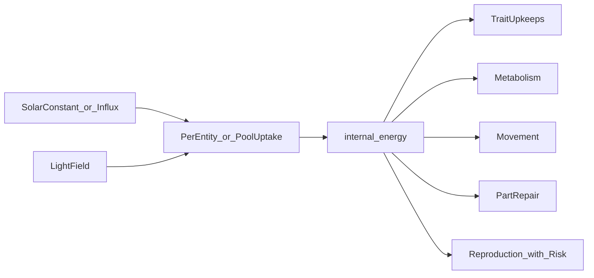

# Energy and Environment

This document describes configurable energy models, per-entity energy and health economics, the light field, thermal vents, hazards, and soup compounds.

## Design problem: per-entity vs global energy

**Per-entity irradiance** (`gain = photo_strength * light(pos) * solar_constant`) is simple and valid for early development. The failure mode is **runaway total influx**: if every organism independently harvests the sun, total energy entering the world scales with population, weakening selection toward “always reproduce.”

**Global pool** fixes world-level influx but requires competition rules so one agent cannot drain the planet.

**Spatial shading** reduces local light under crowding (canopy effect) without a global pool.

**Recommendation:** implement model **A** first; add tradeoffs (`photo_upkeep`, metabolism) so model A still self-limits; add **C** when uniform light collapses diversity; add **B** only if runs still cheat thermodynamics.

## Energy models

| Model | Config | Behavior | Best for |
|-------|--------|----------|----------|
| **A. Local** | `energy_model = "local"` | `gain_i = photo_strength_i * light(pos_i) * solar_constant`; world influx **independent** of population | Phase 1–2, genetics debugging |
| **B. Pool** | `energy_model = "pool"` | `AvailableSolarEnergy += solar_influx * Δt` (capped); entities compete for share in spatial cell | Explicit scarcity, density-dependent selection |
| **C. Spatial** | `energy_model = "spatial"` | Extends A or B: `light(pos)` reduced by local crowding / occlusion | Niche diversity via position |

### Model A — per-entity irradiance

```text
gain = photo_strength * light(pos) * solar_constant
cost = photo_upkeep + metabolism_base + trait_upkeeps
Δinternal_energy = gain - cost   // per tick, before movement/repair/repro
```

`solar_constant` is fixed world parameter; does not multiply by population.

### Model B — global pool + competition

Resource `AvailableSolarEnergy` (f32):

```text
AvailableSolarEnergy = min(solar_cap, AvailableSolarEnergy + solar_influx * Δt)
```

Per entity *i* in spatial cell *c*:

```text
competition_weight_i = photo_strength_i * light(pos_i)
share_i = competition_weight_i / sum_j(competition_weight_j)   // j in cell c
gain_i = share_i * uptake_rate * AvailableSolarEnergy
```

Deduct aggregated uptake from pool after all entities processed (order-stable iteration). Prevents one entity consuming the entire pool in one pass.

### Model C — spatial shading

After base light sample `light_0(pos)`:

```text
occlusion = sum_k f(radius_k, distance_k)   // nearby entities block light
light(pos) = light_0(pos) * max(0, 1 - occlusion)
```

Use with A or B. Parameters: occlusion radius, strength, optional height from `body_radius`.

### Interim crowding (pre–Phase 6, not canonical)

An early experiment zeros **all** photosynthetic gain for any entity whose circle overlaps another that tick (binary, both parties). This is **not** Model C (no graded occlusion, no `light(pos)` reduction). Phase 2 replaces the flat grant with position-based gain and **disables** this behavior by default (`crowding_blocks_photosynthesis = false` in `configs/default.toml`); enable the flag only for A/B experiments. Canonical spatial selection uses the light field (`gradient_y`) in Phase 2; graded occlusion under `energy_model = "spatial"` is planned for **Phase 6** (see [PHASE_2.md](PHASE_2.md#design-decision-crowding-and-overlap-interim-vs-target) and [ROADMAP.md](ROADMAP.md)).



## Per-entity energy & health

### Internal energy

- Scalar `internal_energy >= 0` (clamp or death on underflow policy).
- Spent on: metabolism, photo/armor/sensor upkeeps, movement, repair, reproduction costs, endowment transfer.

### Health (required)

| Layer | Phase | Description |
|-------|-------|-------------|
| **Core HP** | 1+ | Body viability; `core_hp <= 0` → death |
| **Part HP** | 4+ with morphology | One entry per morphology node + core; localized damage |

### Repair

```text
energy_spent = (hp_repaired / repair_efficiency) * repair_energy_per_hp
part_hp += hp_repaired
```

Policies (config):

- `repair_policy = "core_first"` — Protect vital body before appendages
- `repair_policy = "cheapest"` — Repair smallest deficit per energy (efficient recovery)
- `repair_policy = "symmetric"` — Round-robin across damaged parts

Damaged effects:

- Sensory nodes: `effective_bandwidth = visual_bandwidth * (part_hp / max_hp)`
- Locomotion nodes: add `drag` penalty
- Core damage may cap max energy or movement until repaired

### Trait upkeeps (per tick)

| Upkeep | Scales with |
|--------|-------------|
| `photo_upkeep` | `photo_strength` |
| `armor_upkeep` | `skin_hardness` |
| `chemo_upkeep` | `chemo_potential` (if raw > 0, even when inactive) |
| `sensor_upkeep` | `sensory_gain`, `visual_bandwidth`, node count |
| `node_upkeep` | Sum over morphology nodes |

Apply after gains, before movement.

## Light field

| Mode | Config | Description |
|------|--------|-------------|
| **uniform** | `light_mode = "uniform"` | `light = 1` everywhere |
| **gradient_y** | `light_mode = "gradient_y"` | Brighter at top or bottom; encourages vertical niches |
| **map** | `light_mode = "map"` | 2D grid from image or procedural; blocked = shade |

Sampling: bilinear interpolate at entity position. Light is unitless multiplier unless documented otherwise.

## Thermal vents (Phase 5)

Circular zones: `{ center, radius, vent_flux }`.

- **Energy channel:** entities with `chemo_potential` above cliff gain `chemo_gain = chemo_potential_active * vent_flux * chemo_sensitivity`.
- **Barrier mode (optional):** high damage or outward force at vent rim.
- **Threshold:** below cliff, `chemo_potential` gene pays upkeep but provides no vent gain—hill-climb required.

## Hazards (Phase 4)

| Type | Effect |
|------|--------|
| **Zone hazard** | `damage_per_tick` while overlapping; split across hit parts or core |
| **Collision** | `damage ∝ relative_speed * (1 - mitigation(hardness))` |

Mitigation from `skin_hardness` with documented diminishing returns (e.g. `mitigation = hardness / (hardness + k)`).

Damage routing:

1. If morphology present: distribute to appendages by exposure, then overflow to core
2. Else: subtract from `core_hp` only

## Soup compounds (Phase 6)

Scalar fields on grid or global pools: e.g. `amino_acids`, `sugars`.

```text
gain_compound = transporter_efficiency_c * concentration(pos) * uptake_rate
```

- **Transporter loci** (future bytes in reserved region or extension): efficiency per compound type
- Compounds regenerate: `conc += regen_rate * Δt` toward `conc_max`
- Competing uptake optional (similar to pool model B)

Enables niches distinct from photosynthesis (e.g. heterotrophs in rich soup patches).

## Interaction with reproduction

Reproduction costs (`repro_cost`, `offspring_endowment`) apply after metabolism and gains for the tick (see [SIMULATION.md](SIMULATION.md) order). Low energy during repro increases death probability (see [GENOME.md](GENOME.md)).

## Further reading

- [GENOME.md](GENOME.md) — Loci that drive uptake and costs
- [ENTITIES.md](ENTITIES.md) — Lifecycle and death conditions
- [SIMULATION.md](SIMULATION.md) — Tick order and config keys
