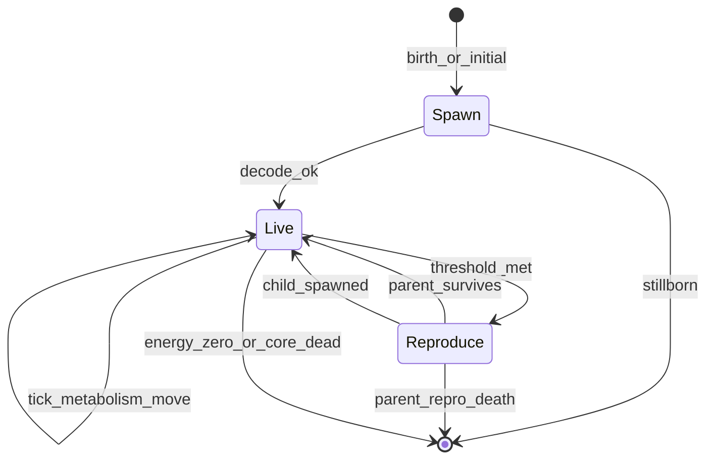

# Entities

This document describes logical ECS components, the entity lifecycle (spawn, live, reproduce, die), interactions, and the performance failsafe.

## Component model

Logical components for implementation (names may map 1:1 to Bevy components):

| Component | Fields (conceptual) | Role |
|-----------|---------------------|------|
| `Genome` | `bytes: Vec<u8>`, `version: u8` | Heritable DNA; mutated on reproduction |
| `Phenotype` | Decoded scalars + derived traits + optional `Morphology` | Cache rebuilt on birth / mutation |
| `Energy` | `internal_energy: f32` | Spendable energy store |
| `Health` | `core_hp`, `core_max_hp`, `part_hp: Vec<f32>` | Part vector aligns with morphology nodes |
| `Transform` | position, rotation (2D) | World placement |
| `Velocity` | `Vec2` | Motion; capped by `phenotype.max_speed` |
| `Agent` | `radius` (from phenotype), collision flags | Physics and rendering hull |
| `Lineage` | `id`, `parent_id`, `generation` | Optional tracking and metrics |
| `Cooldowns` | `repro_ticks_remaining` | Reproduction timer |
| `Age` | `ticks: u32` | Sim age since spawn; compared to decoded `max_age_ticks` (Phase 3) |

### Phase availability

| Component | Phase 0 (now) | Phase 1+ |
|-----------|---------------|----------|
| Genome, Phenotype, Energy, Health | — | Core |
| Lineage, Cooldowns | — | Phase 1 |
| Age | — | Phase 3 |
| part_hp | — | Phase 4+ (morphology) |

## Lifecycle

### Spawn

1. Obtain genome (ancestor template, random viable, or mutated child).
2. Validate header / version; on failure → stillborn (no entity).
3. Decode → `Phenotype`; build `Health` (full core HP; part HP from morphology).
4. Set `internal_energy` from config spawn energy or `offspring_endowment`.
5. Assign `Transform` / `Velocity` (random or offset from parent).
6. Spawn visual representation from `color_*` and `body_radius`.

### Live (each tick)

Order follows [SIMULATION.md](SIMULATION.md):

1. Sample environment at position.
2. Apply energy gains (photosynthesis / chemo / soup per phase).
3. Subtract upkeeps and metabolism.
4. Movement if `internal_energy` covers `move_cost`; apply moving metabolism.
5. Resolve damage to parts / core.
6. Repair if policy allows and energy available.
7. Decrement repro cooldown.

### Reproduce

**Preconditions:**

- `repro_ticks_remaining == 0`
- `internal_energy >= repro_threshold`

**Steps:**

1. Pay `repro_cost` from parent energy.
2. Compute `p_death` from [GENOME.md](GENOME.md) repro risk formula; roll RNG → parent dies on failure.
3. On success: clone genome, apply `mutations_per_offspring`, decode child.
4. Transfer `offspring_endowment` to child `internal_energy` (deduct from parent).
5. Spawn child near parent; set `Lineage.parent_id`, increment `generation`.
6. Reset parent cooldown from `phenotype.repro_cooldown`.

**Failure modes (configurable):**

- `failed_spawn` — energy lost, no child
- `partial_damage` — parent survives, core or random part loses HP

Short cooldown increases reproduction attempts but amplifies risk when energy is chronically low.

### Death

Despawn when any of:

| Condition | Phase |
|-----------|-------|
| `internal_energy <= 0` | 1+ |
| `core_hp <= 0` | 1+ |
| Repro risk roll kills parent | 1+ |
| `age_ticks >= phenotype.max_age_ticks` | 3+ (heritable locus; see [PHASE_3.md](PHASE_3.md)) |
| Performance failsafe cull | emergency only |

**Phase 0 note:** collision overlap currently despawns both entities. This is **removed** in Phase 1 default config; collisions become damage (Phase 4) or ignored.

## Interactions

| Interaction | Phase | Behavior |
|-------------|-------|----------|
| World bounds | 0+ | `bounce` or `wrap` per config |
| Entity–entity collision | 4+ | Damage from relative speed; no instant despawn |
| Hazard zones | 4+ | Damage per tick; hardness mitigates |
| Predation / absorption | future | Optional; out of v1 scope |

## Performance failsafe (not ecology)

When `population > max_entities` ([SIMULATION.md](SIMULATION.md)):

- Log warning with tick and count.
- Apply `failsafe_policy`: `stop_spawns`, `despawn_lowest_energy`, or `pause`.
- **Do not** bias despawn toward low-fitness genetically—`despawn_lowest_energy` is a CPU relief valve, not selection.

Natural population regulation:

- Energy scarcity (model B or C)
- Metabolism and upkeeps
- Reproduction cost and risk
- Hazards and localized niches

## Metrics hooks

Per-entity events (optional log):

- `Birth { id, parent_id, generation, tick }`
- `Death { id, reason, tick }`
- `Reproduction { parent_id, child_id, tick }`

Aggregates in [ARCHITECTURE.md](ARCHITECTURE.md).

## Further reading

- [GENOME.md](GENOME.md) — What gets inherited and mutated
- [ENERGY_AND_ENVIRONMENT.md](ENERGY_AND_ENVIRONMENT.md) — Gains, costs, damage
- [ARCHITECTURE.md](ARCHITECTURE.md) — Where systems live in code
- [ROADMAP.md](ROADMAP.md) — When each interaction lands
