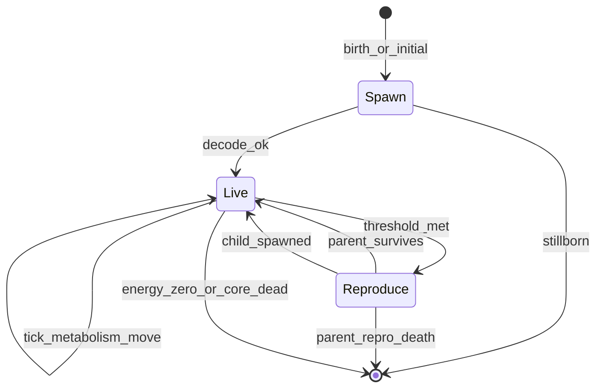

# Entities

This document describes logical ECS components, the entity lifecycle (spawn, live, reproduce, die), interactions, and the performance failsafe.

## Component model

Logical components for implementation (names may map 1:1 to Bevy components):

| Component | Fields (conceptual) | Role |
|-----------|---------------------|------|
| `Genome` | `bytes: Vec<u8>`, `version: u8` | Heritable DNA; mutated on reproduction |
| `Phenotype` | Decoded scalars + derived traits + optional `Morphology` | Cache rebuilt on birth / mutation |
| `Energy` | `internal_energy: f32` | Spendable energy store |
| `Health` | `core_hp`, `core_max_hp`, `part_hp: Vec<f32>` | Part vector aligns with morphology nodes |
| `Transform` | position, rotation (2D) | World placement |
| `Velocity` | `Vec2` | Motion; capped by `phenotype.max_speed` |
| `Agent` | `radius` (from phenotype), collision flags | Physics and rendering hull |
| `Lineage` | `id`, `parent_id`, `generation` | Optional tracking and metrics |
| `Cooldowns` | `repro_ticks_remaining` | Reproduction timer |
| `Age` | `ticks: u32` | Sim age since spawn; drives logarithmic age metabolism |

### Phase availability

| Component | Phase 0 (now) | Phase 1+ |
|-----------|---------------|----------|
| Genome, Phenotype, Energy, Health | — | Core |
| Lineage, Cooldowns | — | Phase 1 |
| Age | — | Phase 3 (**implemented**) |
| part_hp | — | Phase 4: always `[]` at spawn (core-only damage); Phase 7: one entry per morphology node |

## Lifecycle

### Spawn

1. Obtain genome (ancestor template, random viable, or mutated child).
2. Validate header / version; on failure → stillborn (no entity).
3. Decode → `Phenotype`; build `Health` (full core HP; `part_hp: []` until Phase 7 morphology).
4. Set `internal_energy` from config spawn energy or `offspring_endowment`.
5. Assign `Transform` / `Velocity` (random or offset from parent).
6. Spawn visual representation from `color_*` and `body_radius`.

### Live (each tick)

Order follows [SIMULATION.md](SIMULATION.md):

1. Sample environment at position.
2. Apply energy gains (photosynthesis / chemo / soup per phase).
3. Subtract upkeeps and metabolism.
4. Movement if `internal_energy` covers speed-scaled movement cost (`movement_energy_per_tick`); optional moving metabolism when `k_move_meta > 0`.
5. Resolve damage to parts / core (Phase 4: core only when `part_hp` empty).
6. Repair if policy allows and energy available.
7. Decrement repro cooldown.

### Reproduce

**Preconditions:**

- `repro_ticks_remaining == 0`
- `internal_energy >= repro_threshold`

**Steps:**

1. Pay `repro_threshold` energy from parent; parent core HP unchanged ([GENOME.md](GENOME.md) energy→HP transfer).
2. Roll `p_death` and `p_damage` from [GENOME.md](GENOME.md) (scaled by `repro_risk_factor`).
3. On success: clone genome, apply `mutations_per_offspring`, decode child.
4. Child spawns with `internal_energy = 0` and `core_hp` from converted energy (`offspring_endowment` cap).
5. Place child near parent; set `Lineage.parent_id`, increment `generation`.
6. Reset parent cooldown from `phenotype.repro_cooldown`.

**Failure modes:**

- Lethal HP cost — parent dies before rolls if vitality payment empties core HP
- `p_death` — parent dies, no child
- Stillborn — rolls passed but child genome invalid (parent survives, transfer already paid)
- `p_damage` — parent survives but loses a fraction of `core_max_hp`

Short cooldown increases reproduction attempts but amplifies risk when energy is chronically low.

### Death

Despawn when any of:

| Condition | Phase |
|-----------|-------|
| `core_hp <= 0` | 1+ (includes starvation: metabolic deficit at `internal_energy == 0`) |
| Repro risk roll kills parent | 1+ |
| Performance failsafe cull | emergency only |

Old-age despawn was removed; aging adds logarithmic metabolism instead ([GENOME.md](GENOME.md)).

`internal_energy == 0` is **not** fatal. Unpaid metabolic deficit (costs minus photosynthetic gain) drains `core_hp` each tick until the agent dies as `CoreDestroyed`.

**Phase 0 note:** collision overlap currently despawns both entities. This is **removed** in Phase 1 default config; collisions become damage (Phase 4) or ignored.

## Interactions

| Interaction | Phase | Behavior |
|-------------|-------|----------|
| World bounds | 0+ | `bounce` or `wrap` per config |
| Entity–entity collision | 4+ | Damage from relative speed; no instant despawn |
| Hazard zones | 4+ | Damage per tick; hardness mitigates |
| Predation / absorption | future | Optional; out of v1 scope |

### Damage routing (Phase 4 vs 7)

| `part_hp` | Phase | Incoming damage |
|-----------|-------|-----------------|
| Empty (`[]`) | 4 (now) | All hazard and collision damage subtracts from `core_hp` via `Health::apply_damage_to_core` |
| Non-empty | 7+ | Route to appendages by exposure; overflow to core |

Repair (Phase 4D) may restore `core_hp` and any manually populated `part_hp` slots per `repair_policy`; interaction damage remains core-only until Phase 7.

## Performance failsafe (not ecology)

When `population > max_entities` ([SIMULATION.md](SIMULATION.md)):

- Log warning with tick and count.
- Apply `failsafe_policy`: `stop_spawns`, `despawn_lowest_energy`, or `pause`.
- **Do not** bias despawn toward low-fitness genetically—`despawn_lowest_energy` is a CPU relief valve, not selection.

Natural population regulation:

- Energy scarcity (model B or C)
- Metabolism and upkeeps
- Reproduction cost and risk
- Hazards and localized niches

## Metrics hooks

Per-entity events (optional log):

- `Birth { id, parent_id, generation, tick }`
- `Death { id, reason, tick }`
- `Reproduction { parent_id, child_id, tick }`

Aggregates in [ARCHITECTURE.md](ARCHITECTURE.md).

## Further reading

- [GENOME.md](GENOME.md) — What gets inherited and mutated
- [ENERGY_AND_ENVIRONMENT.md](ENERGY_AND_ENVIRONMENT.md) — Gains, costs, damage
- [ARCHITECTURE.md](ARCHITECTURE.md) — Where systems live in code
- [ROADMAP.md](ROADMAP.md) — When each interaction lands
