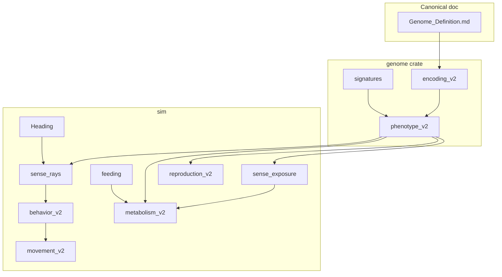

# Project roadmap — [Genome_Definition.md](Genome_Definition.md) as canonical spec

**Authority:** [Genome_Definition.md](Genome_Definition.md) is the **single source of truth** for genetics **and** the simulation behaviors that genetics implies (vitality, metabolism, movement, sensing, pursue/avoid, reproduction, feeding, environment sampling).

**Legacy:** [GENOME.md](GENOME.md), [GENOME_REVISIONS.md](GENOME_REVISIONS.md) (stubs → [`docs/archive/`](archive/)) describe the removed `EVO1` implementation.

**Config:** [CONFIG.md](CONFIG.md) + [`configs/genome_v2.example.toml`](../configs/genome_v2.example.toml). **Not in genome ⇒ not heritable** (age metabolism, repro risk, cooldown, …). **All decode constants ⇒ config** (no Rust literals for 6553.5, 0.1 photo rate, etc.).

**Status:** **EVO2 only** (`configs/default.toml`). v1 removed (Phase G). Encoding = **`EVO2`** fixed 24-byte core + variable pursue/avoid slots (see spec byte map).

---

## Audit summary (spec vs old roadmap vs codebase)

### What the first roadmap got wrong

| Issue | Correction |
|-------|------------|
| Ancestor hex `…000080…` | Healing + ratio are **4 bytes**: `0000` + `0080`, not a single 2-byte healing field `000080` |
| `CORE_FIXED_LEN` | **24 bytes** through pursue/avoid **counts**; slots start at offset **24** |
| Example diagram column “Energy” | Mislabeled — those 3 bytes are **photo / biomass / minerals** efficiencies |
| Ancestor “must move” | Spec ancestor is **sessile** (`max_speed = 00`); viability is **photo-only** until mutation |
| Armor “FF = 25.5” on 2-byte field | Full `u16` scale: `FFFF` → 25.5 stroke units; metabolism/speed use `/65535` |
| Energy/health ratio | **First byte** of 2-byte locus drives 99%/1% ↔ 1%/99% caps; second byte reserved |
| Invalid signature types | **Non-matching** only (not “ignored”) |
| Scope = genome crate only | Spec requires **heading**, **behavior FSM**, **dual caps**, **feeding**, **corpse/mineral fields**, visual **armor stroke** |
| `chemo_potential` locus | **Removed** in spec — use **minerals digestion** + signature `0x0201` / future `0x0204` |
| Phase 5 `repro_cost` sensors | **Cancelled** — sensors are bytes 20–21 in this spec |
| v1 age metabolism gene | **Not in spec** — config-only or extension; drop `max_age` death alignment |

### What the spec still leaves to config / follow-up

| Topic | Recommendation |
|-------|----------------|
| Triad inverse formula `f(photo, biomass, minerals)` | Pick one in `[genetics.v2]` (e.g. `max(other_eff)`); unit-test monotonicity |
| `0.1 × radius` photo rate | Per-**second** in spec → multiply by `Δt` each tick |
| Repro risk, cooldown, stillbirth | Keep **config-only** ([ENTITIES.md](ENTITIES.md)) until spec adds them |
| Movement distance calibration `10 × radius` | Retain from [GENOME_REVISIONS.md](GENOME_REVISIONS.md) as default unless playtest overrides |
| Max pursue/avoid slots / `max_genome_bytes` | Cap in config (e.g. 8 slots each, 512 B total) |
| Collision / hazards | Keep Phase 4 systems; damage still applies to `core_hp` under dual vitality |

### Critical codebase gap (not in v1)

**No agent heading** — sensors, pursue turn, and avoid 180° require a **`Heading`** component (or `Transform.rotation` in 2D). Velocity-only movement cannot implement the spec.

---

## 1. Project-wide impact map

| Area | v1 today | Required by spec |
|------|----------|------------------|
| **[Genome_Definition.md](Genome_Definition.md)** | New | Canonical — updated with byte map + simulation contract |
| **[GENOME.md](GENOME.md)** | Active | Mark **legacy v1**; point to Genome_Definition |
| **[ENTITIES.md](ENTITIES.md)** | `internal_energy` + `core_hp` | **Max** energy & health from radius + ratio; repro % thresholds; endowment from **combined** pools |
| **[ENERGY_AND_ENVIRONMENT.md](ENERGY_AND_ENVIRONMENT.md)** | `photo_strength`, greenness | `0.1×radius×photo_eff`, triad coupling, minerals/corpse sampling |
| **[SIMULATION.md](SIMULATION.md)** | 11-system pipeline | Insert **sense rays → behavior → metabolism → movement**; add heading |
| **[ARCHITECTURE.md](ARCHITECTURE.md)** | `genome/`, `sim/systems/*` | `signatures`, `perception`, `behavior`, `feeding`, `Heading` |
| **[VISION.md](VISION.md)** | Cites GENOME.md | Cite Genome_Definition; tradeoffs = triad + armor + healing cost |
| **[ROADMAP.md](ROADMAP.md)** | Phases 5–7 | **Re-plan:** Phase 5C–F sensor bytes → v2; vents via minerals + signatures |
| **[PHASE_5.md](PHASE_5.md)** | `repro_cost` sensors | **Defer** 5C–5D; keep 5A–5B vents only as v1 bridge |
| **`configs/*.toml`** | `EVO1`, `ancestor_hex` | `EVO2`, new ancestor `00FF05…` (24 B core) |
| **`src/genome/*`** | 28-byte core | `encoding_v2`, `phenotype_v2`, `signatures`, `mutation_v2` |
| **`src/sim/components`** | `Energy`, `Health` | `max_energy`, `max_health` (or caps on existing components) |
| **`src/sim/systems/movement`** | Random velocity | Heading, turn desire, pursue/avoid overrides |
| **`src/sim/systems/metabolism`** | v1 photo + chemo | v2 photo + sensor upkeep; minerals via vents/field |
| **`src/sim/systems/reproduction`** | Absolute threshold | % max energy; % combined endowment |
| **`src/sim/systems/healing`** | `repair_rate` | `healing_rate` u16 + cost penalty coupling |
| **`src/sim/systems/sense`** | Light/hazard/vent exposure | + **ray cast** perception for signatures |
| **`src/visual`** | Circle agents | Armor stroke width; optional sensor rays |
| **Metrics JSONL** | v1 aggregates | Caps, efficiencies, behavior state counts |

---

## 2. Canonical encoding (aligned with spec)

### 2.1 Fixed core (24 bytes)

Identical to [Genome_Definition.md — Fixed core byte map](Genome_Definition.md#fixed-core-byte-map).

**Ancestor (hex, 24 bytes, no slot payload):**

```text
00FF05 000A 0000 0000 0080 FF0F 00000000 FF0000 0000 0000
```

With `EVO2` header prepended for `ancestor_hex` in config.

### 2.2 Decode highlights

| Chromosome | Decode notes |
|------------|----------------|
| Body `u16` | Radius: `0000` → **4.0** units; `FFFF` → **1314.70**; same raw drives **+6553.5** max energy and **+65.535** metabolism demand at max |
| Armor `u16` | Stroke `raw/65535×25.5`; meta **+65.535%** at max; speed **×(1 − 0.65535×raw/65535)** |
| Healing `u16` | `FFFF` → **3.27675×** heal speed, **13.107×** cost vs base 1 HP/s |
| Ratio byte 0 | `lerp` energy cap fraction 99% → 1% |
| Efficiencies u8 | `/255`; triad inverse between photo/biomass/minerals (**no** color nibble cap — revision 2026-06) |
| Sensors | Mask popcount divides strength byte; avoid distance budget uses per-eye reach |
| Max speed `00` | **Zero** locomotion — valid |

### 2.3 Pursue / avoid

- Pursue slots bytes `[24 .. 24+Σpursue)]`, then avoid slots.
- Simple slot: 6 bytes; AND: `0x0100`, arity ≤ 4.
- Registry & fuzzy rules: spec table + per-nibble ±1.

---

## 3. Target architecture



### Module list

| Module | Responsibility |
|--------|----------------|
| `genome/encoding_v2.rs` | `EVO2`, offsets, length validation |
| `genome/signatures.rs` | Parse slots, fuzzy match, AND groups |
| `genome/phenotype_v2.rs` | All decode formulas + triad |
| `genome/mutation_v2.rs` | Chromosome + slot mutations |
| `genome/decode.rs` | Dispatch v1/v2 by `genome_version` |
| `sim/components/heading.rs` | `Heading(radians)` on agents |
| `sim/perception.rs` | Ray/arc samples → observations |
| `sim/systems/sense_rays.rs` | After `sense_exposure` |
| `sim/systems/behavior_v2.rs` | Pursue / avoid / wander intent |
| `sim/systems/feeding.rs` | Biomass/minerals ingest (Phase 6 soup) |
| `sim/systems/metabolism_v2.rs` | Photo 0.1×r, sensor upkeep, deficits |
| `visual/armor.rs` | Stroke from armor decode |

---

## 4. Simulation pipeline (target)

```text
environment_tick
sense_exposure          # light, hazards, vent flux → minerals bridge
sense_rays              # 8-direction perception, signature observations
behavior_v2             # avoid > pursue > wander (sets desired heading/velocity)
metabolism_and_gains_v2 # photo, upkeep, digestion, drain energy then health
behavior_movement_v2    # desire, turn, integrate, move cost × efficiency
interactions            # legacy collision/hazard (port to vitality model)
healing_v2
reproduction_v2
death_and_despawn
failsafe
metrics_sample
```

**Remove for v2 default:** v1 `advance_age` / `max_age_ticks` death unless kept as config-only tax without a gene.

---

## 5. Implementation phases

### G0 — Spec & doc alignment ✅ (this pass)

- [x] Fix byte map, ancestor breakdown, simulation contract in [Genome_Definition.md](Genome_Definition.md)
- [x] Genome vs global config rules + [CONFIG.md](CONFIG.md) + [genome_v2.example.toml](../configs/genome_v2.example.toml)
- [x] Legacy banners on [GENOME.md](GENOME.md), [VISION.md](VISION.md), [ROADMAP.md](ROADMAP.md), [PHASE_5.md](PHASE_5.md)
- [x] Wire `GeneticsDecodeV2` in `config.rs` (implementation)
- [x] Lock triad `coupling_mode` in tests once code exists

### G1 — Encoding & decode ✅

`EVO2`, variable slots, `PhenotypeV2`, `[genetics.decode_v2]` in `config.rs`, ancestor config, golden decode tests — **every phenotype field traced to a config key**.

### G2 — Vitality & metabolism ✅

`max_energy` / `max_health`, ratio locus, radius-linked metabolism, photo triad, deficit → HP — `metabolism_v2.rs`, `Energy.max_internal_energy`, spawn caps, `metabolism_and_gains` dispatch.

### G3 — Heading, movement, armor, healing ✅

**Heading** component; armor stroke + penalties; healing u16; sessile ancestor tests + mobile mutant tests.

### G4 — Sense rays & signatures ✅

8-ray perception, fuzzy registry, debug draw; no FSM yet.

### G5 — Pursue / avoid behavior ✅

`BehaviorState`, avoid distance budget, pursue steering.

### G6 — Reproduction ✅

% thresholds, combined-pool endowment, child health/overflow energy.

### G7 — Feeding & environment ✅

Corpses (`0x0200`), mineral field (`0x0201`), soup Phase 6 minimal; v2 uses minerals digestion + vent bridge (no `chemo_potential`).

### G8 — Cutover ✅

**EVO2 only** — `configs/default.toml`; v1 removed (Phase G); ENTITIES, ENERGY, SIMULATION, ARCHITECTURE, metrics updated.

---

## 6. v1 → v2 migration (reference)

| v1 | v2 |
|----|-----|
| `photo_strength` + greenness | Photo u8 gene (color cosmetic only in v2) |
| `metabolism_base` | Radius + armor derived |
| `locomotion` + `movement_pace` | `max_speed` + `movement_efficiency` u8 |
| `skin_hardness` | Armor u16 |
| `repair_rate` | Healing rate u16 (cost coupling) |
| `repro_threshold` u16 abs | Repro % of max energy |
| `offspring_endowment` u16 | Endowment % combined pools |
| `chemo_potential` | Minerals u8 + signatures |
| `repro_cost` / Phase 5 sensors | Sensors 20–21 |
| `age_metabolism_scale` | Config extension only |

---

## 7. Acceptance criteria (project-level)

1. [Genome_Definition.md](Genome_Definition.md) byte map matches `encoding_v2` constants and tests.
2. 24-byte ancestor decodes sessile, photo-capable, repro at 100% energy, ~6% endowment.
3. Agent with `max_speed > 0` pays move cost modulated by movement efficiency and armor.
4. Pursue color `0000 000000FF05` turns toward matching agent; avoid `0200` flees 180° at max speed.
5. Fuzzy: `0x0A` matches `0x09`/`0x0B`, not `0x07`.
6. Dual vitality: ratio byte `00` vs `FF` produces different max E/H caps from same radius.
7. ~~v1 regression~~ — removed in Phase G; only `genome_version = 2` loads.

---

## 8. Documentation maintenance

When implementing, update **in the same PR**:

- [ENTITIES.md](ENTITIES.md) — vitality caps, repro %, endowment pools
- [ENERGY_AND_ENVIRONMENT.md](ENERGY_AND_ENVIRONMENT.md) — photo formula, minerals, corpses
- [SIMULATION.md](SIMULATION.md) — pipeline + heading
- [ARCHITECTURE.md](ARCHITECTURE.md) — new modules
- [ROADMAP.md](ROADMAP.md) — v2 track supersedes Phase 5C–5D on v1

**Do not** let [GENOME.md](GENOME.md) diverge as a second authority — only historical v1 reference.
