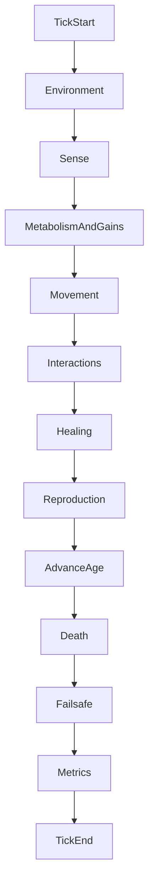

# Simulation

This document covers the simulation time model, randomness and reproducibility, configuration schema, runtime modes, and the canonical per-tick system order.

## Time model

- **Fixed sim tick** `Δt` — All rates are defined either *per tick* or *per second* with an explicit conversion (e.g. `rate_per_tick = rate_per_sec * Δt`). Default starting point: `Δt = 1/60` s (one minute of sim time ≈ 3600 ticks at 60 Hz).
- **Tick counter** — Monotonic `u64` incremented once per full pipeline pass.
- **Substeps (optional, later)** — Movement and collision may use substeps within a tick if needed for stability. Genetics, energy, and reproduction run on the tick boundary unless documented otherwise.

Wall-clock time does not drive simulation logic; only `Δt` and tick count matter.

## Randomness vs reproducibility

**Mutations are necessarily random.** “Determinism” in this project means **reproducible stochasticity**, not predictable evolutionary outcomes.

| Mode | Behavior |
|------|----------|
| **With `master_seed`** | Same config + seed ⇒ same sequence of mutation draws, spawn jitter, repro-risk rolls, and tie-breaks on rerun |
| **Without seed** | OS/thread RNG; each run is independent; evolution still works |

Seeding is a **developer and science convenience**, not a gameplay requirement. Recommended practice:

- Derive sub-streams from `master_seed` (e.g. SplitMix64) keyed by `entity_id`, `generation`, and event class (`spawn`, `mutation`, `repro_risk`) so unrelated events do not consume each other’s entropy.
- Document **float policy** if bit-identical replay across machines matters: prefer stable iteration order; note that `f32` arithmetic may differ slightly across platforms.

### Event log (optional, Phase 2+)

Append-only records: `Birth`, `Death`, `Reproduction`, `MutationSummary` with tick, entity id, and reason. Enables validation without full state replay.

## Configuration (`SimConfig`)

Structured **TOML** files in `configs/` (e.g. `configs/default.toml`).

**v2 rules** ([Genome_Definition.md](Genome_Definition.md), [CONFIG.md](CONFIG.md)):

- **Genome bytes** — only heritable per-agent variation (chromosomes + pursue/avoid slots).
- **Everything else** — global config, identical for all organisms in a run (age metabolism, repro risk, cooldown, spawn energy, hazard placement, and **all constants used to decode** genome bytes into phenotypes).
- Example v2 template: [`configs/genome_v2.example.toml`](../configs/genome_v2.example.toml).

Suggested top-level sections:

### `[world]`

| Key | Type | Description |
|-----|------|-------------|
| `width`, `height` | f32 | World size in sim units (pixels in visual mode) |
| `boundary` | enum | `bounce` or `wrap` |
| `initial_population` | usize | Count at startup (or `1` for single ancestor) |

### `[performance]`

| Key | Type | Description |
|-----|------|-------------|
| `max_entities` | usize | **Failsafe only** — emergency policy when exceeded (see below) |
| `failsafe_policy` | enum | `stop_spawns`, `despawn_lowest_energy`, `pause` |

Natural population limits come from energy, metabolism, and environment—not from `max_entities`.

### `[environment]` (Phase 2 — implemented)

| Key | Type | Status | Description |
|-----|------|--------|-------------|
| `energy_model` | string | **implemented** | `local` (default, Model A), `legacy_flat` (Phase 1 flat grant regression). `pool` / `spatial` error at load |
| `solar_constant` | f32 | **implemented** | Per-entity irradiance scale when `energy_model = "local"` |
| `light_mode` | string | **implemented** | `uniform` or `gradient_y` ([`LightField`](../src/sim/light.rs)) |
| `gradient_axis` | string | **implemented** | `y` only (reserved for future axes) |
| `gradient_min`, `gradient_max` | f32 | **implemented** | Light multiplier range for `gradient_y` |
| `gradient_bright_at` | string | **implemented** | `top` or `bottom` — which world edge is brightest |
| `crowding_blocks_photosynthesis` | bool | **implemented** | Default `false`. If `true`, binary circle overlap zeros photosynthetic gain that tick (experiment only; see [PHASE_2.md](PHASE_2.md)) |
| `solar_influx`, `solar_cap` | f32 | Phase 6 | Pool recharge and cap (model B) |
| `light_mode = "map"` | — | Phase 5+ | Image / procedural grid |
| `vents` | array | Phase 5+ | Position, radius, flux |
| `hazards` | array | **implemented** | Circular zones: `center`, `radius`, `damage_per_tick` ([`HazardField`](../src/sim/hazards.rs)) |
| `[genetics.color_photosynthesis]` | table | **v1 removed** | Historical greenness niche ([PHASE_4.md](PHASE_4.md) §4.7); v2 color is cosmetic — [Genome_Definition.md](Genome_Definition.md) |
| `seasons_enabled` | bool | Phase 9 | Default `false`; cyclic environment modulation |
| `seasons` | array | Phase 9 | Named keyframes: `duration_ticks`, optional overrides (`solar_constant`, `gradient_max`, scales) — [PHASE_9.md](PHASE_9.md) |

**Phase 1 migration:** `[economy].flat_energy_grant_per_tick` is unused when `energy_model = "local"`. Use `legacy_flat` or keep a non-zero flat grant for old configs. See [README.md](../README.md) and [PHASE_2.md](PHASE_2.md).

**Per-tick gain (local):** `photo_strength * light(pos) * solar_constant` minus metabolism and trait upkeeps ([`metabolism_and_gains`](../src/sim/systems/metabolism.rs), after [`sense_exposure`](../src/sim/systems/sense.rs)).

### `[genetics]`

| Key | Type | Description |
|-----|------|-------------|
| `genome_version` | u8 | Must be `2` (EVO2) |
| `core_length` | usize | Fixed core byte length |
| `[genetics.mutation_v2]` | table | **v2:** `passes_min`, `passes_max`, `p_large_step`, `large_step_min`, `large_step_max` — see [Genome_Definition.md](Genome_Definition.md#mutation-v2) |
| `p_bit_flip`, `p_point`, … | f32 | **v1 only** — legacy mutation operators |

### `[genetics.decode_ranges]` (lifespan — Phase 3)

| Key | Type | Status | Description |
|-----|------|--------|-------------|
| `age_min_ticks` | f32 | **implemented** | Shortest decoded lifespan (`lerp_u16` min) |
| `age_max_ticks` | f32 | **implemented** | Longest decoded lifespan |
| `age_ref_ticks` | f32 | **implemented** | Normalization for `age_upkeep` |
| `k_age` | f32 | **implemented** | Per-tick longevity cost scale |

See [PHASE_3.md](PHASE_3.md) and [GENOME.md](GENOME.md). Other decode keys (`body_radius_min`, `photo_max`, …) are Phase 1+.

### `[economy]`

Baseline values used when decoding or as config floors; many are overridden or scaled by genes.

| Key | Type | Description |
|-----|------|-------------|
| `metabolism_floor` | f32 | Minimum idle drain |
| `flat_energy_grant_per_tick` | f32 | Used only when `environment.energy_model = "legacy_flat"`; default `0.0` under `local` |
| `repro_safety_margin` | f32 | Fraction of `repro_threshold` below which repro risk rises |
| `p_death_on_repro_base` | f32 | Base reproduction fatality chance at low energy |
| `repair_energy_per_hp` | f32 | Energy per HP restored |
| `repair_hp_per_tick_at_rate_1` | f32 | Max HP/tick at `repair_rate = 1.0` |

### `[run]`

| Key | Type | Description |
|-----|------|-------------|
| `max_ticks` | u64 | Headless termination |
| `snapshot_interval` | u64 | Ticks between metrics samples |
| `metrics_path` | path | Output JSON/JSONL file |
| `master_seed` | u64 | Optional; omit for nondeterministic runs |

## Runtime modes

| Mode | CLI | Behavior |
|------|-----|----------|
| **Visual** | `cargo run -- --config configs/default.toml` | Bevy window; shared sim tick chain each frame |
| **Headless** | `cargo run -- --headless --config configs/default.toml` | No window; runs until `run.max_ticks`, truncates and writes `run.metrics_path` JSONL |

Optional `--seed U64` overrides `run.master_seed` after TOML load. Default config path: `configs/default.toml`.

### Sync contract (visual)

- Visual layer receives **read-only snapshots**: position, velocity, color, radius, optional debug overlays (light sample, energy bar).
- Visual layer **must not** mutate simulation state or apply gameplay rules.
- Pausing the window pauses snapshot consumption only if sim thread is coupled; preferred: sim runs in fixed step, render interpolates.

## Canonical system order (per tick)

Implement systems in this order (see [ARCHITECTURE.md](ARCHITECTURE.md)):

1. **Environment tick** — **Implemented:** soup regen, corpse TTL ([`environment_tick`](../src/sim/systems/environment_tick.rs)); Phase 9 seasons later
2. **Sense / exposure** — **Implemented:** light, hazards, vents (v1 chemo only), `MineralExposure` ([`sense_exposure`](../src/sim/systems/sense.rs))
3. **Sense rays** (v2) — **Implemented:** 8-direction cones, pursue/avoid signatures → `SensePerception` ([`sense_rays`](../src/sim/systems/sense_rays.rs))
4. **Behavior** (v2) — **Implemented:** avoid > pursue > wander → `BehaviorState` ([`behavior_v2`](../src/sim/systems/behavior_v2.rs))
5. **Feeding** (v2) — **Implemented:** minerals, corpses, soup ([`feeding_v2`](../src/sim/systems/feeding_v2.rs))
6. **Metabolism & gains** — v1 Model A; v2 photo triad + sensor upkeep ([`metabolism_v2`](../src/sim/systems/metabolism_v2.rs))
7. **Behavior / movement** — v1 random velocity; v2 heading + pursue / avoid flee ([`movement_v2`](../src/sim/systems/movement_v2.rs))
8. **Interactions** — hazard zones only → `core_hp` ([`interactions`](../src/sim/systems/interactions.rs); no entity–entity collision damage)
9. **Healing** — v1 repair policy; v2 `healing_rate` gene ([`healing_v2`](../src/sim/systems/healing_v2.rs))
10. **Reproduction** — v1 absolute threshold; v2 % max energy + combined endowment ([`reproduction_v2`](../src/sim/systems/reproduction_v2.rs))
11. **Advance age** — `Age.ticks += 1` (global age metabolism; no `max_age` gene in v2)
12. **Death & despawn** — core HP ≤ 0, repro fatality; v2 corpses optional
13. **Performance failsafe** — `population > max_entities`
14. **Metrics sample** — JSONL includes `genome_version`, v2 caps, behavior counts ([`metrics`](../src/sim/metrics.rs))

## Performance failsafe policies

When `population > max_entities`:

| Policy | Action |
|--------|--------|
| `stop_spawns` | Block new spawns from reproduction; existing entities continue |
| `despawn_lowest_energy` | Remove lowest-energy entities until at cap |
| `pause` | Halt tick advancement; log error (for interactive debugging) |

Never use failsafe as a fitness mechanic or evolutionary pressure.

## Further reading

- [VISION.md](VISION.md) — Goals and principles
- [ENERGY_AND_ENVIRONMENT.md](ENERGY_AND_ENVIRONMENT.md) — Energy model details
- [ENTITIES.md](ENTITIES.md) — Lifecycle and components
- [ARCHITECTURE.md](ARCHITECTURE.md) — Module layout
