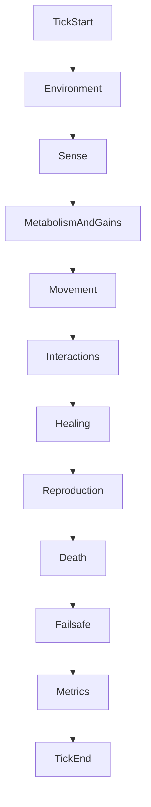

# Simulation

This document covers the simulation time model, randomness and reproducibility, configuration schema, runtime modes, and the canonical per-tick system order.

## Time model

- **Fixed sim tick** `Δt` — All rates are defined either *per tick* or *per second* with an explicit conversion (e.g. `rate_per_tick = rate_per_sec * Δt`). Default starting point: `Δt = 1/60` s (one minute of sim time ≈ 3600 ticks at 60 Hz).
- **Tick counter** — Monotonic `u64` incremented once per full pipeline pass.
- **Substeps (optional, later)** — Movement and collision may use substeps within a tick if needed for stability. Genetics, energy, and reproduction run on the tick boundary unless documented otherwise.

Wall-clock time does not drive simulation logic; only `Δt` and tick count matter.

## Randomness vs reproducibility

**Mutations are necessarily random.** “Determinism” in this project means **reproducible stochasticity**, not predictable evolutionary outcomes.

| Mode | Behavior |
|------|----------|
| **With `master_seed`** | Same config + seed ⇒ same sequence of mutation draws, spawn jitter, repro-risk rolls, and tie-breaks on rerun |
| **Without seed** | OS/thread RNG; each run is independent; evolution still works |

Seeding is a **developer and science convenience**, not a gameplay requirement. Recommended practice:

- Derive sub-streams from `master_seed` (e.g. SplitMix64) keyed by `entity_id`, `generation`, and event class (`spawn`, `mutation`, `repro_risk`) so unrelated events do not consume each other’s entropy.
- Document **float policy** if bit-identical replay across machines matters: prefer stable iteration order; note that `f32` arithmetic may differ slightly across platforms.

### Event log (optional, Phase 2+)

Append-only records: `Birth`, `Death`, `Reproduction`, `MutationSummary` with tick, entity id, and reason. Enables validation without full state replay.

## Configuration (`SimConfig`)

Structured **TOML** files in `configs/` (e.g. `configs/default.toml`). Suggested top-level sections:

### `[world]`

| Key | Type | Description |
|-----|------|-------------|
| `width`, `height` | f32 | World size in sim units (pixels in visual mode) |
| `boundary` | enum | `bounce` or `wrap` |
| `initial_population` | usize | Count at startup (or `1` for single ancestor) |

### `[performance]`

| Key | Type | Description |
|-----|------|-------------|
| `max_entities` | usize | **Failsafe only** — emergency policy when exceeded (see below) |
| `failsafe_policy` | enum | `stop_spawns`, `despawn_lowest_energy`, `pause` |

Natural population limits come from energy, metabolism, and environment—not from `max_entities`.

### `[environment]`

| Key | Type | Description |
|-----|------|-------------|
| `energy_model` | string | `local`, `pool`, or `spatial` — see [ENERGY_AND_ENVIRONMENT.md](ENERGY_AND_ENVIRONMENT.md) |
| `solar_constant` | f32 | Per-entity irradiance scale (model A) |
| `solar_influx`, `solar_cap` | f32 | Pool recharge and cap (model B) |
| `light_mode` | string | `uniform`, `gradient_y`, or `map` |
| `vents` | array | Position, radius, flux (Phase 5+) |
| `hazards` | array | Zones with damage rate (Phase 4+) |

### `[genetics]`

| Key | Type | Description |
|-----|------|-------------|
| `genome_version` | u8 | Must match encoder (currently `1`) |
| `core_length` | usize | Fixed core byte length |
| `p_bit_flip`, `p_point`, `p_resample`, `p_dup`, `p_del` | f32 | Mutation probabilities |
| `mutations_per_offspring` | u32 | Expected mutation passes on reproduce |
| `delta_max` | u8 | Max byte delta for point noise |

### `[economy]`

Baseline values used when decoding or as config floors; many are overridden or scaled by genes.

| Key | Type | Description |
|-----|------|-------------|
| `metabolism_floor` | f32 | Minimum idle drain |
| `repro_safety_margin` | f32 | Fraction of `repro_threshold` below which repro risk rises |
| `p_death_on_repro_base` | f32 | Base reproduction fatality chance at low energy |
| `repair_energy_per_hp` | f32 | Base cost before `repair_efficiency` |

### `[run]`

| Key | Type | Description |
|-----|------|-------------|
| `max_ticks` | u64 | Headless termination |
| `snapshot_interval` | u64 | Ticks between metrics samples |
| `metrics_path` | path | Output JSON/JSONL file |
| `master_seed` | u64 | Optional; omit for nondeterministic runs |

## Runtime modes

| Mode | CLI (target) | Behavior |
|------|----------------|----------|
| **Visual** | `cargo run -- --config configs/default.toml` | `SimCore` advances; Bevy syncs read-only snapshot each frame (or every *k* ticks) |
| **Headless** | `cargo run -- --headless --config configs/default.toml` | Runs `max_ticks`, writes metrics, exits without window |

### Sync contract (visual)

- Visual layer receives **read-only snapshots**: position, velocity, color, radius, optional debug overlays (light sample, energy bar).
- Visual layer **must not** mutate simulation state or apply gameplay rules.
- Pausing the window pauses snapshot consumption only if sim thread is coupled; preferred: sim runs in fixed step, render interpolates.

## Canonical system order (per tick)

Implement systems in this order (see [ARCHITECTURE.md](ARCHITECTURE.md)):

1. **Environment tick** — Solar pool recharge (model B), compound regeneration placeholder, vent flux update
2. **Sense / exposure** — Sample light, vent proximity, hazard overlap, soup concentration at each entity position
3. **Metabolism & gains** — Photosynthesis / chemosynthesis uptake, then subtract `photo_upkeep`, trait upkeeps, base metabolism
4. **Behavior / movement** — Apply velocity intent; deduct movement energy from `move_cost` and moving metabolism
5. **Interactions** — Collision damage, hazard damage, feeding placeholder (later)
6. **Healing** — Spend energy to repair core and body parts per policy
7. **Reproduction** — Cooldown check, threshold, pay `repro_cost`, roll repro risk, spawn child with mutations and endowment
8. **Advance age** — `Age.ticks += 1` per living agent (Phase 3)
9. **Death & despawn** — `internal_energy <= 0`, `core_hp <= 0`, `age_ticks >= max_age_ticks` (Phase 3), repro fatality
10. **Performance failsafe** — If `population > max_entities`, apply emergency policy and log warning
11. **Metrics sample** — If `tick % snapshot_interval == 0`, record aggregates (include lifespan stats / `age_exceeded` deaths in Phase 3)

## Performance failsafe policies

When `population > max_entities`:

| Policy | Action |
|--------|--------|
| `stop_spawns` | Block new spawns from reproduction; existing entities continue |
| `despawn_lowest_energy` | Remove lowest-energy entities until at cap |
| `pause` | Halt tick advancement; log error (for interactive debugging) |

Never use failsafe as a fitness mechanic or evolutionary pressure.

## Further reading

- [VISION.md](VISION.md) — Goals and principles
- [ENERGY_AND_ENVIRONMENT.md](ENERGY_AND_ENVIRONMENT.md) — Energy model details
- [ENTITIES.md](ENTITIES.md) — Lifecycle and components
- [ARCHITECTURE.md](ARCHITECTURE.md) — Module layout
