# Introduction

Microcosm is a side-on slice of an ocean in which life evolves without help. A new world starts with one kind of organism: a tiny green cell that floats near the surface, photosynthesizes, and has no body parts, so it cannot move. Every other way of living has to evolve from it: swimming, sensing, hunting, scavenging, living off vent minerals, breathing or doing without oxygen, armor, poison, large bodies.

Nothing in the simulation decides what should evolve. Each organism carries a genome. The genome sets its body, its chemistry and its behavior. Offspring inherit the genome with occasional random changes. Organisms whose genomes suit the conditions around them gather more energy, reproduce more, and their genes spread. Those that don't, die out. Species, food webs and extinctions are the result.

This guide explains the rules: the world, its chemistry, the genome, how bodies are built from it, how organisms feed, move, reproduce and die, and how species are recognized and named.

**About the numbers.** Every number in this guide is a default from `configs/default.toml` or a constant in the simulation code. A world can be started with a different configuration, which changes them.

**Units.** Distances are in world *units*. Times are in simulation seconds; at 1× speed a simulation second is a real second. One *tick* is 1/30 of a second, and the simulation runs 30 ticks per second at 1×.

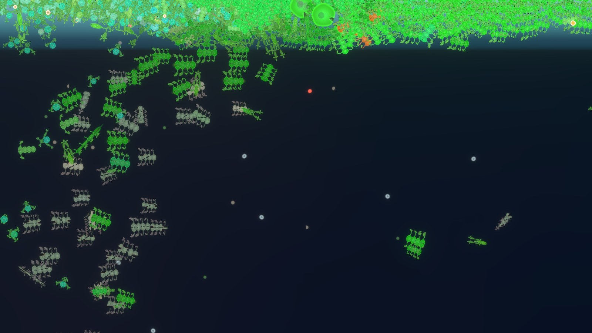

# The World

## The ocean

The world is a vertical cross-section of an ocean, seen from the side. The water surface is at the top, the seafloor at the bottom. Rock blocks movement and light. A world's size and terrain come from its *map*. The game ships with one map, **Deep Ocean**: 20,400 units wide, with the water surface 6,000 units above the bottom of the map. The open ocean fills the left 12,000 units. Its floor lies about 4,400 to 4,700 units down, with a trench reaching 5,850. On the right, a cliff rises to a shallow shelf, and beyond it the rock rises above the water as land. Caves and tunnels run through the rock.

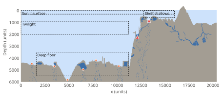

The same map can be used with any world seed. The seed decides everything else: where the first organisms start, the currents, which vents open when, and when events strike.

| Region | Depth | What sets it apart |
|---|---|---|
| Sunlit surface | 0–500 | Most light, warmest water, strongest currents. Photosynthesizers crowd here and shade each other. |
| Twilight water | 500–2,500 | Light fades to about 1% of the surface level by 2,660 units. The water is near 6 °C by 1,500. |
| Deep water | 2,500 to the floor | Dark and about 4 °C. Rich in nutrients, poorer in oxygen. Marine snow falls through it and piles up on the floor. |
| Deep floor | 4,200–5,850 | Six fixed points where temporary vents open |
| Cliff | 500–4,600 | The steep wall at the right of the open ocean (x ≈ 11,000–12,500), from the deep floor up to the shelf. A permanent vent sits on it about 2,240 units down. |
| Shelf | 480–910 | A rock shelf from x ≈ 12,500 to 16,500 under 480 to 910 units of water, which gets about 20–45% of the surface light. A permanent vent sits in a hollow in its floor, about 850 units down. |
| Caves | in the rock | Hollow chambers and tunnels. Their water is dark and keeps filling with detritus and nutrients: a home for scavengers that do without oxygen. Narrow entrances keep large bodies out. |

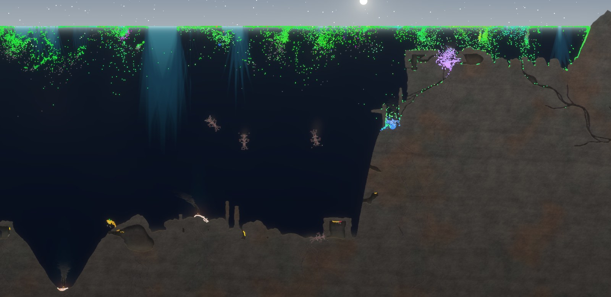

## Time

| Period | Length at 1× | Effect |
|---|---|---|
| Tick | 1/30 s | One step of the simulation |
| Day | 10 min (600 s) | Sunlight rises and falls. Night keeps 20% of noon light. A world starts at 07:00. |
| Season | 1.5 days | Spring, summer, autumn, winter |
| Year | 6 days (1 hour) | Sunlight varies ±30% and surface temperature ±6 °C over the year |
| Climate | many years | A slow random walk of global temperature, up to ±8 °C, plus warming from CO₂ in the air |

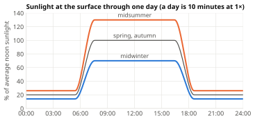

## Light

Sunlight enters at the surface and is traced straight down each 16-unit column of water. Water absorbs it steadily: light halves every 400 units of depth. Rock stops it completely.

Bodies absorb light too. Each body intercepts light in proportion to its width and its *absorptance*: 0.1 for any body, plus 0.8 × its photosynthesis capability (see *Diet*). Light absorbed by photosynthetic pigment becomes energy for that organism. Light absorbed by the rest of the body is lost. What passes through continues down. A dense bloom at the surface therefore shades everything below it, and the shadow is visible in the game.

Lures (a body part) also give off light. To organisms, lure light counts the same as sunlight.

## Temperature

Surface water is 20 °C on average, plus the season (±6 °C), the climate drift (up to ±8 °C) and greenhouse warming. Below the surface the temperature falls toward 4 °C, closing about two thirds of the gap by 700 units down. Vents heat the water around them by up to 45 °C, fading over about 260 units.

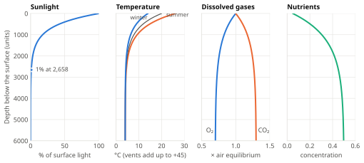

## Currents

Water moves in slow gyres everywhere (about 3,000 units across, up to 3 units per second) and in faster eddies in the top 450 units (about 450 units across, up to 8 units per second, strongest at the surface). The flow pattern shifts over minutes. It neither piles water up nor empties it out, and it never flows out through the surface. Everything that isn't anchored drifts with it, including dead bodies.

## Vents

Hydrothermal vents pour hot, mineral-rich, oxygen-free water into the deep.

- A vent at full strength releases 30 units of mineral energy per second. 65% pours out at the vent and rises in a plume at 4 units per second. The other 35% seeps out over 240 units around its base.
- Vents also release CO₂ and nutrients, and remove oxygen from the water around them.
- The two **permanent vents** on Deep Ocean never fade.
- Up to three **temporary vents** are open at a time. Each opens at one of the six vent points on the deep floor, lasts 2 to 8 hours, flares up over the first tenth of its life and fades out over the last 30%, and has its own peak strength (60–140%).

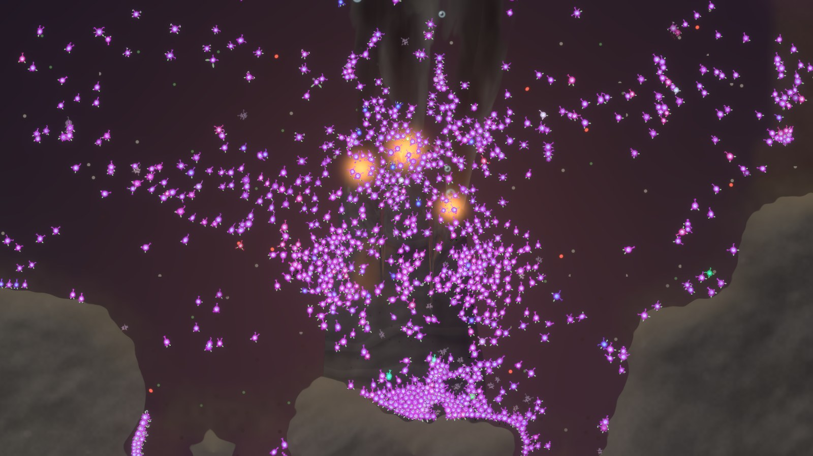

# Water Chemistry

The water carries eight substances, each stored on a grid of cells. Organisms sense them, use them, and release them.

| Substance | Grid cell | Comes from | Is removed by |
|---|---|---|---|
| Light | 16 units | The sun, lures | Water, bodies, rock |
| Temperature | 64 units | Surface, depth, vents | — (recomputed every second) |
| Minerals | 32 units | Vents, rotting detritus, meteor impacts, upwellings | Chemosynthesis, sulfur photosynthesis, slow precipitation |
| Detritus | 32 units | Corpses, uneaten scraps, fermentation waste, caves | Scavengers, rotting |
| Oxygen | 32 units | Photosynthesis, the air | Breathing, rotting, vents |
| CO₂ | 32 units | Breathing, fermenting, rotting, vents | Photosynthesis, the air |
| Nutrients | 32 units | Deep water, rotting marine snow, excretion, vents, upwellings | Uptake by organisms |
| Toxin | 32 units | Toxic organisms | Breaks down (half-life about 35 s) |

All of them spread (diffuse) through the water. Rock cells hold nothing.


## Oxygen, CO₂ and the air

Oxygen and CO₂ are measured so that 1.0 is water in balance with today's air. Photosynthesis makes oxygen and uses CO₂. Breathing and rotting use oxygen and make CO₂.

The top layer of water exchanges gases with the **air**, which holds two global levels: oxygen and CO₂ (1.0 = today's). The air is large, so it changes over days. CO₂ in the air warms the climate by 3 °C for every doubling. A world can be started with almost no oxygen in the air (`initial_oxygen = 0.05`); its life then has to oxygenate the planet.

Deep water slowly returns toward its usual make-up: less oxygen (0.7) and more CO₂ (1.3) than surface water. This stands in for ocean circulation the simulation doesn't model.

## Minerals, detritus and marine snow

**Minerals** are chemical energy dissolved in the water. Chemosynthesizers live on them. They come from vents and from rotting detritus, and slowly precipitate out (0.4% per second).

**Detritus** is dead organic matter: bodies, scraps and waste. It sinks at 3 units per second as **marine snow** and piles up on the seafloor. It rots at 0.15% per second. Rotting uses oxygen and releases CO₂ and minerals. Where oxygen is scarce, it rots at half the speed and releases nearly twice the minerals (sulfides). Scavengers eat detritus.

## Nutrients and the biological pump

Building body mass takes nutrients: one unit of nutrients per unit of mass. Organisms take nutrients from the water, make them, or eat them in other bodies.

When an organism dies, the nutrients in its body go into its carcass. As the carcass rots they are bound into marine snow, sink with it, and are released into the water wherever the snow rots, mostly deep down. Life near the surface therefore keeps carrying nutrients into the deep. Blooms empty the sunlit water of nutrients while the deep fills up, until upwellings, vents and slow mixing bring them back. What a living organism excretes stays where it is, so animals that feed near photosynthesizers fertilize them.

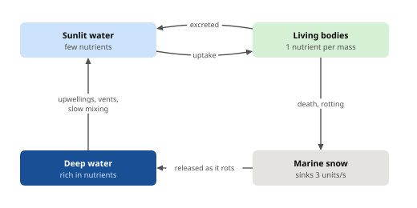

## Toxin

Organisms with the Toxin gene leak poison into the water: 0.05 × Toxin × radius per second. It spreads and breaks down by 2% per second. Toxin damages organisms in proportion to its concentration, and small bodies suffer more (damage is divided by 1 + radius ÷ 8). It matters mostly in dense blooms of a toxic producer, the equivalent of a red tide.

Toxin carries the color of the organisms that made it. Organisms whose hue matches it closely are immune: the producers themselves, their relatives, and look-alikes of the same color. The Resistance gene blocks up to 90% of the damage from any toxin.

# The Genome

## Structure

A genome is 60 bytes. **Each byte is one gene**, and each gene means one thing. The bytes are grouped into nine chromosomes, each named by a letter. Genomes are written in hexadecimal, two digits per byte (`00` to `FF`, or 0 to 255):

```
B:20A050200000 C:55C000 D:FF000000 G:E0FF80000000 H:2030 N:80808080808080808000
P:000000 000000 000000 000000 000000 000000 000000 000000 R:FF00B0 T:80A0
```

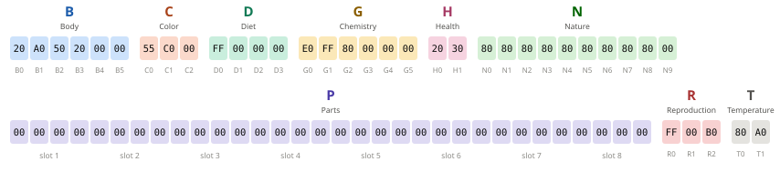

| Chromosome | Genes | Controls |
|---|---|---|
| **B** Body | 6 | Size, buoyancy, energy storage, lifespan, shape, segments |
| **C** Color | 3 | Hue, saturation, pattern |
| **D** Diet | 4 | Photosynthesis, chemosynthesis, scavenging, hunting |
| **G** Chemistry | 6 | Breathing, oxygen release, nutrients, toxin |
| **H** Health | 2 | Healing and toughness |
| **N** Nature | 10 | Behavior: nine drives and restlessness |
| **P** Parts | 24 | Up to eight body parts, three bytes each |
| **R** Reproduction | 3 | Offspring size, brood size, when to breed |
| **T** Temperature | 2 | Preferred temperature and tolerance |

Most genes are read as a fraction from 0 (`00`) to 1 (`FF`). The nine drive genes are *signed*: `80` means zero, lower values mean "away" and higher values mean "toward".

There are no animal or plant genes. An organism's way of life is the sum of what its genes do, so "predator", "plant" or "oxygen producer" are outcomes, not categories.

## Upkeep: every ability costs energy

An organism burns energy all the time just to stay alive (its *basal metabolism*, see *Life*). Most genes add to it. Each such gene adds its *upkeep* times its strength to a multiplier, **U = 1 + the sum of all upkeep**, and basal metabolism is multiplied by U. A bare body with nothing switched on has U = 1. The ancestor has U ≈ 2.07. Upkeep for diet genes is charged on the effective capability rather than the raw byte (see *Diet*). Body parts have their own upkeep.

## Gene reference

In the tables, *g* is the byte (0–255) and *f* = g ÷ 255.

### B — Body

| Gene | Name | Meaning | Upkeep |
|---|---|---|---|
| B0 | Size | Adult radius = 2^(g ÷ 32). Every `20` more doubles the radius: `00` = 1, `20` = 2, `40` = 4, `60` = 8, `80` = 16, `A0` = 32, `C0` = 64, `E0` = 128, `FF` ≈ 250. Mass = radius². | — |
| B1 | Buoyancy | Signed. `00` sinks, `80` neutral, `FF` floats. Heavy body parts pull it down. Drift speed = buoyancy × 3 × √radius units per second. | 0.3 f |
| B2 | Reserves | Energy storage = (0.3 + 2.7 f) × mass | 0.3 f |
| B3 | Longevity | Lifespan = 300 s × √radius × (1 + 3 f) | 0.4 f |
| B4 | Elongation | From round (`00`) to 4 times as long as wide (`FF`), keeping the same area, tapering toward the tail | — |
| B5 | Segments | 1 + (g × 6 ÷ 256): 1 to 6 segments | 0.05 per extra segment |

### C — Color

| Gene | Name | Meaning |
|---|---|---|
| C0 | Hue | 0–360° around the color wheel |
| C1 | Saturation | 20–100% |
| C2 | Pattern | Top 2 bits: plain, spots, stripes or rings. The rest: the pattern's scale. |

Color has no upkeep and no effect except through toxin immunity (see *Toxin*) and recognition by name. The color genes mutate three times as often as other genes, so lineages that split drift apart in color, which makes them easy to tell apart on screen.

### D — Diet

| Gene | Name | Food | Upkeep |
|---|---|---|---|
| D0 | Photosynthesis | Light | 0.3 × capability |
| D1 | Chemosynthesis | Dissolved minerals | 0.3 × capability |
| D2 | Scavenging | Detritus and carcasses | 0.3 × capability |
| D3 | Hunting | Live organisms | 0.3 × capability |

The diet genes are explained in *Feeding*.

### G — Chemistry

| Gene | Name | Meaning | Upkeep |
|---|---|---|---|
| G0 | Respiration | Share of energy needs met by breathing oxygen. The rest is fermented. | — |
| G1 | Oxygenic | Share of photosynthesis that uses CO₂ and releases oxygen. The rest uses minerals instead and releases none. | — |
| G2 | Nutrient uptake | Rate of taking nutrients from the water | 0.2 f |
| G3 | N-fixation | Makes nutrients from energy | 0.2 f |
| G4 | Toxin | Leaks poison; makes the body poisonous to eat. Values below `06` do nothing. | 0.3 f |
| G5 | Resistance | Ignores up to 90% (0.9 f) of toxin damage | 0.3 f |

### H — Health

| Gene | Name | Meaning | Upkeep |
|---|---|---|---|
| H0 | Regeneration | Heals 0.2–5% of max HP per second, at 1.5 energy per HP | 0.2 f |
| H1 | Toughness | Max HP = (0.3 + 1.7 f) × mass | 0.3 f |

### N — Nature

| Gene | Drive | Responds to |
|---|---|---|
| N0 | Light | Brightness (sunlight and lures) |
| N1 | Warmth | Temperature |
| N2 | Minerals | Mineral concentration |
| N3 | Carrion | Detritus and carcasses |
| N4 | Smaller | Organisms of other species under 80% of its own radius |
| N5 | Larger | Organisms of other species over 125% of its own radius |
| N6 | Kin | Members of its own species |
| N7 | Crowding | Bodies packed within 3 body radii, felt by touch |
| N8 | Oxygen | Oxygen concentration |
| N9 | Restlessness | Cruising speed and random wandering when nothing is sensed (not signed) |

Drives are signed: `80` is indifferent, and they reach full strength at `C0` (toward) and `40` (away). Their effect is described in *Behavior*.

### P — Parts

Eight slots of three bytes each. See *Body Plans*.

### R — Reproduction

| Gene | Name | Meaning |
|---|---|---|
| R0 | Offspring size | Newborn mass = 0.5 × 2^(−(255 − g) ÷ 32) × adult mass. `FF` = 50% (splitting in two), `E0` ≈ 26%, `C0` ≈ 13%, `80` ≈ 3%, `00` ≈ 0.2% |
| R1 | Brood size | 1 + (g ÷ 32, rounded down): 1 to 8 offspring at a time |
| R2 | Patience | Breeds once reserves are at least (30 + 70 f)% full |

### T — Temperature

| Gene | Name | Meaning | Upkeep |
|---|---|---|---|
| T0 | Preferred | 0–40 °C | — |
| T1 | Tolerance | ±1 to ±15 °C, plus up to ±1 °C for each shell plate | 0.4 f |

## The ancestor, decoded

Every new world begins with 2,000 copies of this genome, placed in the chosen start area.

| Genes | Bytes | Meaning |
|---|---|---|
| B | `20 A0 50 20 00 00` | Radius 2. Floats gently. Stores 1.15× its mass in energy. Lives about 580 s (just under a game day). Round, one segment. |
| C | `55 C0 00` | Green (120°), 80% saturated, plain |
| D | `FF 00 00 00` | Pure photosynthesis |
| G | `E0 FF 80 00 00 00` | Breathes oxygen for 88% of its needs. All its photosynthesis releases oxygen. Takes up nutrients at half rate. No fixation, no toxin, no resistance. |
| H | `20 30` | Heals 0.8% of max HP per second. 0.62 HP per unit of mass (fragile). |
| N | `80 80 80 80 80 80 80 80 80 00` | No drives. Never wanders. |
| P | all `00` | No parts: it cannot swim, turn or grip, and senses only 4 body radii around it. |
| R | `FF 00 B0` | Splits in two (one half-size offspring) once reserves are 78% full |
| T | `80 A0` | Prefers 20 °C, tolerates ±9.8 °C |

The optional *vent ancestor* (`population.vent_ancestor`) starts a second lineage at the vents. It is off by default: life has to reach the vents on its own.

# Body Plans

## Body shape

Every body is an ellipse with a front. Its **mouth** is at the front of the head.

- **Elongation** (B4) stretches the body from round to four times as long as wide, keeping its area. Long bodies taper toward the tail. They slip through the water lengthwise with up to 45% less drag but have more drag sideways, and they turn more slowly.
- **Segments** (B5) divide the body into 1 to 6 beads. Each extra segment makes the body 50% longer, costs 5% upkeep, makes building the body 10% more expensive, and slows turning. The head segment is slightly wider and holds the nucleus.

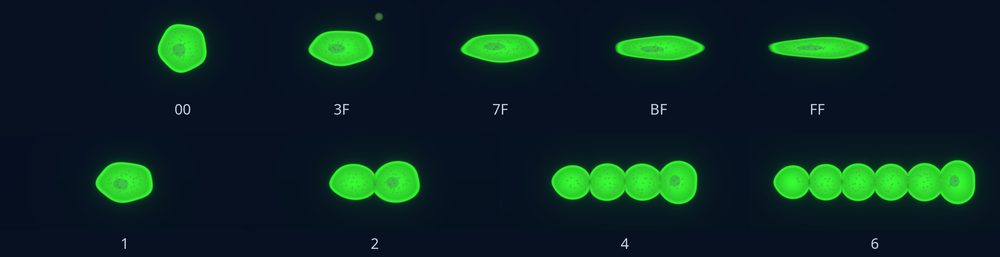

## Part slots

Chromosome P holds eight part slots of three bytes each: **type**, **size** and **place**. A slot whose type has kind 0 is empty.

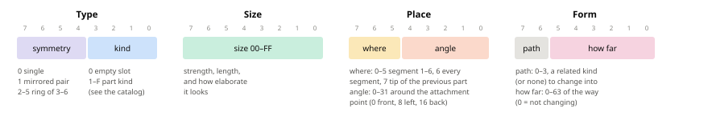

**Type.** The low four bits pick the kind of part (1 to 15, listed in the catalog below). The high four bits set its symmetry: 0 is a single part, 1 a mirrored pair, 2 to 5 a ring of 3 to 6 copies spaced evenly around the body.

**Size.** From `00` to `FF`. Size sets the part's strength and length, and how elaborate it looks: a small eye is a pigment spot, a large one a camera eye.

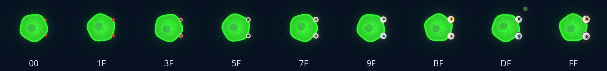

**Place.** The top three bits say where the part grows: 0 to 5 on segment 1 to 6 (counting from the head; a body with fewer segments uses its last one), 6 on every segment, 7 on the tip of the part in the previous slot. The low five bits are the angle, 0 to 31, around the attachment point.

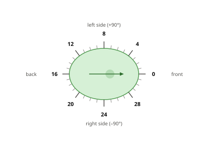

Symmetry and repetition multiply a part. A mirrored pair of legs on every segment of a four-segment body is eight legs. Parts placed on the previous part build trees: an eye on a stalk, fronds on tentacles, a tentacle on every copy of a ring of stalks. An organism can carry at most 48 part instances.

## The part catalog

Fifteen kinds of part. *Length* is in body radii, from size `00` to size `FF`. *Mass*, *upkeep* and *drag* are for one part at full size (`FF`). A smaller part has less, but never less than a fifth: it has 0.2 + 0.8 × (size ÷ 255) of each, so 20% at `00`, 60% at `80` and 100% at `FF`. Each copy (in a pair, a ring, or on every segment) counts separately.

| Kind | Job | Length | Mass | Upkeep | Drag |
|---|---|---|---|---|---|
| 1 Flagellum | Swims by pushing the body away from the side it is on. Best on small bodies. | 0.6–2.4 | 0.02 | 0.12 | 0.02 |
| 2 Cilia band | A little thrust across its axis, turning, filter feeding. Best on small bodies. | 0.15–0.4 | 0.02 | 0.10 | 0.05 |
| 3 Tentacle | Grabs one thing within its own length of its base and drags it to the mouth. Also grips and filters. | 0.7–3.2 | 0.05 | 0.12 | 0.12 |
| 4 Frond | Catches light over a wider span and takes up nutrients | 0.5–2.7 | 0.06 | 0.05 | 0.20 |
| 5 Fin | Swims across its axis and steers. Best on large bodies. | 0.35–1.25 | 0.06 | 0.10 | 0.04 |
| 6 Tail fluke | Powerful swimming away from where it points. Best on large bodies. | 0.35–1.15 | 0.10 | 0.15 | 0.03 |
| 7 Leg | Walks on rock and rows through water, both across its axis; grips against currents | 0.5–1.8 | 0.08 | 0.12 | 0.10 |
| 8 Holdfast | Anchors to rock; triples nutrient uptake while anchored | 0.3–1.3 | 0.06 | 0.05 | 0.15 |
| 9 Stalk | Raises what grows on its tip: those parts work 30% better | 0.4–2.0 | 0.03 | 0.03 | 0.04 |
| A Eye | Widens the sense radius all round | 0.16–0.6 | 0.02 | 0.08 | 0.01 |
| B Antenna | Widens the sense radius all round, exactly like an eye | 0.5–2.7 | 0.02 | 0.08 | 0.03 |
| C Lure | Glows. Organisms drawn to light swim toward it. | 0.5–2.1 | 0.03 | 0.12 | 0.05 |
| D Spine | Hurts attackers on the side it faces | 0.2–1.0 | 0.04 | 0.06 | 0.08 |
| E Jaw | Bite strength. Works best facing forward. | 0.25–0.85 | 0.06 | 0.10 | 0.04 |
| F Shell plate | Armor on the side it faces; insulation. Heavy. | 0.08–0.33 | 0.12 | 0.12 | 0.10 |

Part upkeep is multiplied by 1.5 before it is added to U. For example, a pair of eyes at size `80` adds 2 × 0.08 × 0.6 × 1.5 ≈ 0.14 to U. Part mass is a fraction of body mass: it makes the body more expensive to build and makes it sink (buoyancy drops by 1.5 × total part mass).

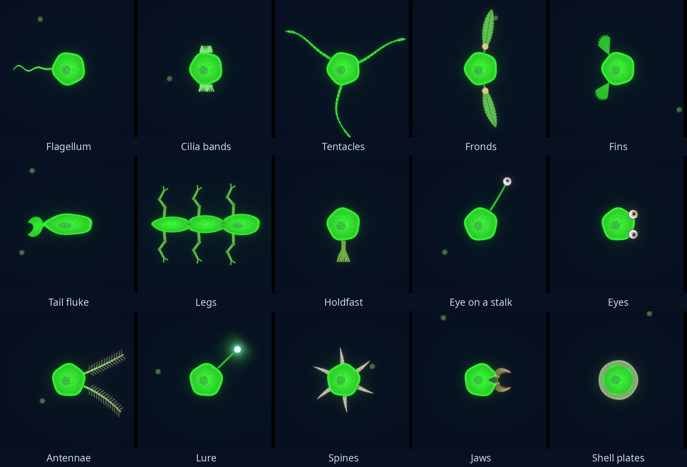

## What parts add up to

When an organism is born, its parts are laid out on its body and summed into a few numbers. These do not change during its life. Most of them (armor, spikes, jaws, lure brightness, grip and the sense bonus) grow with diminishing returns, 1 − e^(−x): the first part helps most.

### Swimming

A movement organ does not push the body one fixed way. It allows movement along certain directions relative to the body, depending on which way it points.

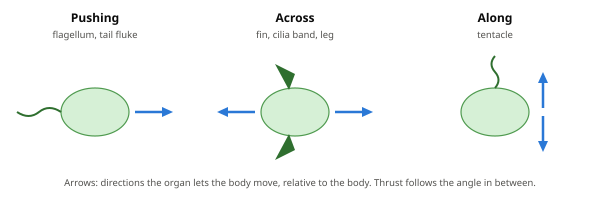

- **Pushing** (flagellum, tail fluke): away from the side the organ is on. A flagellum trailing behind drives the body forward; one at the front drives it tail-first.
- **Across** (fin, cilia band, leg): perpendicular to the organ. Fins on the sides row the body forward and back. Legs pointing down move it forward.
- **Along** (tentacle): a little movement along the tentacle's own axis, either way.

Thrust is summed in eight directions around the body. In each direction, swimming strength = 1 − e^(−thrust ÷ drag). Drag comes from the body's shape and from every part. Top speed = swimming strength × 20 × √radius units per second, reduced by up to 30% by shell armor.

Organ efficiency depends on body size. Flagella and cilia work well on microbes and fade above a radius of about 8. Fins and flukes work at 30% on the smallest bodies and approach full strength on large ones.

| Organ | Thrust per unit of size | Turning per unit of size |
|---|---|---|
| Flagellum | 1.0 × small-body efficiency, pushing | 0.3 |
| Cilia band | 0.35 × small-body efficiency, across | 0.4 |
| Tentacle | 0.1, along | 0.1 |
| Fin | 0.5 × large-body efficiency, across | 0.6 |
| Tail fluke | 1.4 × large-body efficiency, pushing | 0.2 |
| Leg | 0.3 swimming and 0.8 walking, across | 0.15 (0.5 while walking) |

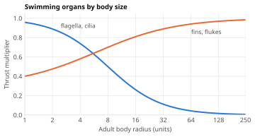

### Moving and turning

Each tick, an organism moves in whichever direction its organs allow that gets it closest to where it wants to go, and turns so that its best direction points there. Forward swimmers face their target. A body that swims best sideways travels sideways.

Turning needs an organ to turn with: flagella, cilia, tentacles, fins, flukes, or legs while walking. A body without any keeps its orientation forever. Turn rate is 0.3 to 6 radians per second depending on the summed turning, and is lower for long and segmented bodies.

### Walking, gripping and anchoring

Only organisms with legs, tentacles or holdfasts check whether they touch rock (within 1.5 radii plus 2 units).

- **Legs** walk on rock and the seafloor at up to 12 × √radius units per second, when that is faster than swimming. Walking costs less energy than swimming.
- **Grip** (legs, tentacles, holdfasts) resists the current and buoyancy while touching rock.
- **Holdfasts** anchor the organism when it touches rock and isn't swimming off (throttle under 30%). An anchored organism does not move at all. Its offspring settle beside it, which builds reefs and kelp-like forests.

### Sensing

An organism senses everything within one radius around it, the same in every direction: light, temperature, chemicals, other organisms and carcasses. Every organism senses 4 body radii around it. Eyes and antennae add to that alike, up to +16 body radii; a pair of full-size eyes gives most of it. Parts on a stalk count 30% more. The sense radius is capped at 1,200 units.

### Armor, spines and jaws

Shell plates and spines protect the side they face: front, left, back or right. A plate mostly guards its own side and adds a little (15%) to all sides. A shell on the back protects against chasers but not against a head-on attack. Each plate also widens the tolerated temperature range by up to ±1 °C.

Jaws add bite strength. A jaw facing forward counts fully; one facing sideways or back counts at 15%.

# Life

## Size, mass and growth

Mass is radius squared. Organisms are born small and grow toward their adult size, investing surplus energy at up to 5% of their mass per second. Each unit of new mass costs 1.25 energy (more with heavy parts or extra segments) and one unit of nutrients. Juveniles keep half of their energy reserves as a buffer and invest the rest. Only adults reproduce, so large organisms spend a long time as juveniles. A juvenile is smaller than its parents, so it can eat different food and be eaten by different hunters.

## Energy

Energy is stored in reserves, up to (0.3 + 2.7 × Reserves) × mass. Each second an organism needs:

```
basal     = 0.003 × mass^0.75 × U × (1 + 0.5 × temperature stress)
movement  = 0.003 × mass^0.75 × 3 × effort × throttle²
```

*Effort* is swimming strength × drag (walking is cheaper). *Throttle* is how hard it is swimming, 0 to 1. Because metabolism grows with mass^0.75, large organisms are cheaper per unit of mass but need more in total.

Gains come from feeding (see *Feeding*). When reserves run out, the shortfall is taken from HP instead: the organism starves.

Energy enters the world only as sunlight and vent minerals and leaves as metabolic heat. Population limits are not set anywhere; they come from competition for that energy.

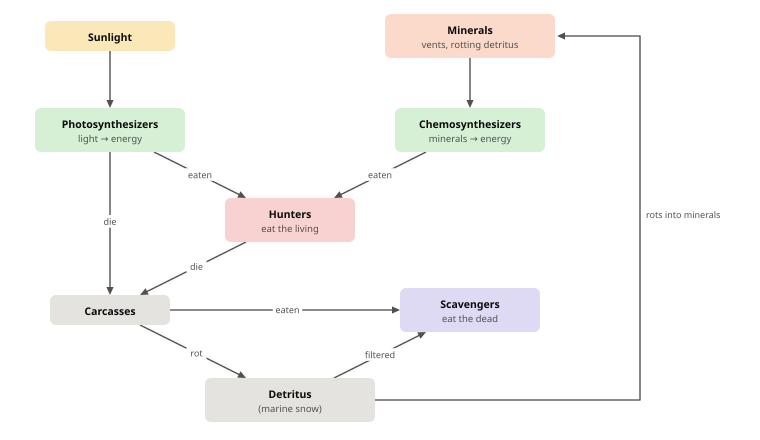

## Breathing and fermenting

Energy needs are met by breathing oxygen or by fermenting.

- An organism breathes oxygen for up to its Respiration share (G0) of its needs, if the water has enough. Below 25% of normal oxygen, breathing falters.
- Everything else is fermented. Every organism can ferment at least 25% of its needs, plus whatever share it doesn't breathe. Fermenting costs 60% more, and half of that extra leaks into the water as organic waste (detritus).
- Needs that neither can meet **suffocate** the organism: up to 20% of max HP per second.
- **Strict fermenters** (Respiration below `80`) are poisoned by oxygen above half the normal level.

Breathing uses oxygen and gives off CO₂. Fermenting gives off CO₂ and waste. Aerobes are cheap to run but die in dead zones. Fermenters live where oxygen is scarce but pay more for everything. Mixes pay a little more everywhere.

## Temperature

Temperature stress *s* = ((water temperature − preferred) ÷ tolerance)². It raises basal metabolism by 50% × *s* (at most ×3). Beyond the tolerance (*s* > 1), it also costs 5% of max HP per second for each unit of *s* above 1.

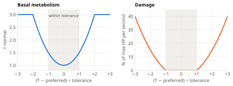

## Health and death

Max HP = (0.3 + 1.7 × Toughness) × mass. HP is lost to starvation, suffocation, temperature, poison, bites and spikes, and healed by Regeneration at 1.5 energy per HP.

| Cause | How |
|---|---|
| Starvation | Energy needs exceed reserves |
| Old age | Past its lifespan, a 20% chance of dying each second |
| Eaten whole | Engulfed by a hunter. Leaves no carcass. |
| Predation | Killed by bites |
| Temperature | Water too far outside its tolerance |
| Spikes | Hurt by the spines of prey it attacked |
| Suffocation | Not enough oxygen for its breathing, not enough fermentation to make up for it |
| Poison | Toxin in the water, oxygen (for strict fermenters), or toxic prey |
| Disease | A plague (see *Events*) |
| Catastrophe | A meteor impact |

## Carcasses

Every death except being eaten whole leaves a **carcass**: a grey, torn copy of the organism, parts included. It sinks at 2 × √radius units per second and drifts with the current. It holds the body's energy (1 per unit of mass, plus whatever reserves were left) and its nutrients.

Carcasses rot into detritus and marine snow. Small ones rot fast, within about a minute; large ones last much longer, so the carcass of a giant feeds a seafloor community for a long time. Scavengers and hunters can eat carcasses on contact, and the bites show.

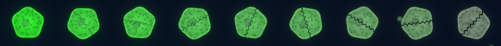

# Feeding

## Diet genes and mixed diets

The four diet genes (D0–D3) set how well an organism uses each food source. Mixing diets has a cost. With *x* the four genes as fractions, each diet's effective **capability** is

```
capability_i = x_i × (1 − 0.4 × the sum of the other three diet genes)
```

A specialist with one gene gets its full value. A small second diet works almost linearly and costs the main diet little. Full generalists lose overall: two full diets give 0.6 each, 1.2 in total, where two specialists would have 2.

Photosynthesis and scavenging also get in each other's way: each loses a further 0.2 × the other's gene.

Upkeep is charged on capability, not on the raw gene, so a weak unused diet gene is cheap. Such genes drift at random, unnoticed, until conditions make them useful.

Hunting capability below 0.05 does nothing.

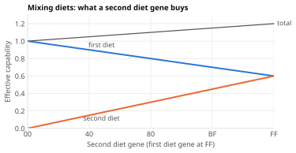

## Photosynthesis

A photosynthesizer gains the light absorbed by its pigment in its light cells: pigment absorptance = 0.8 × photosynthesis capability. Light is caught over the body's width, widened by fronds (each unit of frond length adds 45% of the body's width). Without fronds, large photosynthesizers catch little light for their mass.

The Oxygenic gene (G1) splits photosynthesis in two:

- **Oxygenic** (share G1): uses CO₂ and releases oxygen. It slows when CO₂ runs low.
- **Sulfur-based** (the rest): uses minerals instead and releases no oxygen. It needs minerals in the water, so it works near vents and in rotting zones.

## Chemosynthesis

Chemosynthesizers absorb dissolved minerals: 20 × capability × radius × mineral concentration per second, which depletes the water. Uptake grows with the radius, not the mass, so small bodies do best per unit of mass. Each organism feeds from the 32-unit grid cell it is in. When the organisms in a cell want more than the cell holds, each gets the same fraction of what it asked for, so the cell is emptied and bigger feeders still get more. Nutrient uptake and filtering marine snow are shared the same way.

## Scavenging

Scavengers eat in two ways.

- **Eating marine snow**: filtering detritus from the water and the sediment, at 12 × capability × radius × (1 + filter) × concentration per second. Cilia bands and tentacles raise *filter*. Swimming sweeps more water.
- **Eating carcasses**: on contact at the mouth, at 0.5 × capability × radius² × (0.3 + 1.7 × jaws) per second. Hunters can also eat carcasses, at 70% of their hunting capability. 80% of what is eaten is digested; the rest becomes detritus.

## Hunting

A hunter attacks organisms of other species that touch its **mouth**. Food that only touches the rest of its body is eaten at 30% of the rate, so facing the food pays.

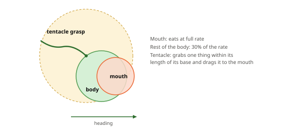

- **Engulfing.** Prey with a radius up to 60% of the hunter's is swallowed whole. The chance per second is 3 × hunting capability, reduced by the prey's armor on the side it is attacked from.
- **Biting.** Larger prey is bitten. The hunter tears off 0.3 × hunting × (0.2 + 1.8 × jaws) × radius² of the prey's mass per second, reduced by the prey's armor on that side. Bitten prey loses mass and HP and has to regrow.
- **Spines.** The prey's spines on the attacked side hurt the hunter in proportion to what it eats.
- **Digestion.** The hunter gains 80% × (0.4 + 0.6 × hunting) of the prey's energy (1 per unit of mass, plus its reserves) and all of its nutrients. What it can't store becomes detritus and excreted nutrients.
- **Poison.** Toxic prey poisons the hunter: damage = 0.8 × prey toxin × mass eaten × (1 − resistance).
- **Kin.** Hunters spare their own species unless their reserves fall below half. Look-alikes of another species are prey.

Shell armor blocks up to 75% of an attack at full strength.

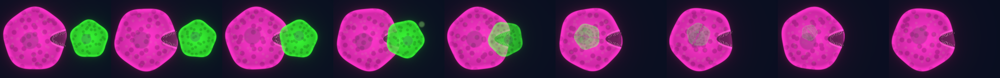

## Tentacles

Tentacles don't eat. Each tentacle grabs one thing (prey or a carcass) within its own length of its base and drags it toward the mouth at 12 × pull × √radius units per second. If the target is behind the body, it is dragged around the side. If the target is heavier than the hunter, the hunter is pulled to it instead; an anchored hunter never moves. A tentacle keeps hold of its catch while it stays in reach. A hunter with eight tentacles can hold eight things at once.

## Nutrients

Every body needs nutrients to grow and reproduce. An organism stores up to its own mass in nutrients and gets them in three ways:

- **Uptake** (G2): from the water, 1.0 × uptake × radius × frond surface × concentration per second, tripled while anchored by a holdfast. Each unit of frond length adds 30% to the surface.
- **Fixation** (G3): makes 0.01 × fixation × mass nutrients per second at 0.5 energy each. Oxygen hampers it (by up to 60%).
- **Eating**: prey and carcasses hand over all their nutrients.

Anything beyond the store is excreted into the water.

# Behavior

## Drives

Organisms that can swim or walk steer by their **drives**, the signed genes N0–N8. Every 2 ticks, each drive turns what the organism senses into a pull toward or away from something. The pulls add up to a heading and a throttle.

- **Fields** (light, warmth, minerals, carrion, oxygen): the organism compares the field across its sense radius and pulls toward the better side, or away from it if the drive is negative.
- **Organisms** (smaller, larger, kin): smaller organisms of other species pull toward the nearest one; larger organisms of other species and members of its own species pull by how close they are. An organism picks out individuals only if they are at least 1/8 of its own size, so a giant ignores single microbes and follows dense food fields instead.
- **Crowding**: bodies within 3 body radii, felt by touch, pull toward them (clumping) or push away (spacing out).
- **Hunger**: the food drives (light, minerals, carrion, smaller) are scaled by hunger, from 0.3× when reserves are full to 1.7× when empty.
- **Restlessness**: when no pull is strong enough, an organism with Restlessness (N9) cruises at up to 60% throttle and turns at random now and then.

Lures count as light, so an organism with a positive light drive swims toward them.

| Drives | Result |
|---|---|
| +Light | Swimming toward the sun (phototaxis) |
| +Minerals, +Warmth | Seeking vents |
| +Smaller | Hunting |
| −Larger | Fleeing |
| +Kin | Schooling |
| −Kin | Spreading out from relatives |
| +Crowding | Mats and clumps |
| +Carrion | Following marine snow and carcasses |
| −Oxygen | Seeking oxygen-poor water (useful for fermenters) |

There is no drive to swim up or down. Bodies rise or sink by buoyancy, and the light drive finds the light.

## Movement and physics

- **Throttle** scales speed: top speed × throttle in the chosen direction.
- **Small bodies stop instantly**; large ones coast.
- **Buoyancy** gives a vertical drift of buoyancy × 3 × √radius units per second.
- **Brownian jitter** shakes only tiny organisms (8 ÷ radius).
- **Currents** carry every organism that isn't anchored, reduced by its grip while touching rock.
- **Collisions**: overlapping organisms push each other apart, the lighter one more. Rock is solid.

## Activity labels

The inspector shows what an organism is doing:

| Label | Meaning |
|---|---|
| Drifting | Not steering |
| Wandering | Cruising at random (restlessness) |
| Foraging | Following light, minerals or carrion |
| Hunting | Chasing a smaller organism |
| Fleeing | Moving away from a larger organism |
| Schooling | Moving with its species, or clumping |
| Feeding | Eating prey |
| Eating a carcass | Feeding on a carcass |
| Eating marine snow | Filtering detritus as a large share of its needs |
| Absorbing minerals | Chemosynthesis as a large share of its needs |

# Reproduction and Mutation

## Budding

An adult reproduces when its reserves reach its Patience threshold (R2). It buds: up to Brood size (R1) offspring of the Offspring size (R0) grow out of its body and pinch off.

- The offspring's body comes **out of the parent's**. The parent loses the offspring's mass, then regrows to adult size at the normal building cost. A fission-sized offspring leaves two halves; a small bud barely changes the parent.
- Each offspring gets energy reserves (half of its capacity) and a nutrient store (a quarter of its capacity) from the parent. Reserves and nutrients the smaller parent can no longer hold go to the offspring.
- A parent keeps at least half of its adult mass, so a fission-sized brood is always one offspring. The brood is also limited by the parent's energy and nutrients.
- After budding, a parent waits at least 2 seconds before budding again.
- Each offspring is placed beside the parent and mutates independently.

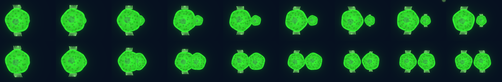

Lineages with many tiny offspring (most of which die young) and lineages with few large ones both evolve, depending on conditions.

## Mutation

Each offspring's genome is copied from its parent's, then changed at random:

| Change | Chance | What happens |
|---|---|---|
| Point mutation | 3% per gene (9% for the three color genes) | 5% of these re-roll the gene to a random value. The rest step it by ±2 (50%), ±4 (25%), ±8 (12.5%) or ±16 (12.5%). Values stop at `00` and `FF`. |
| Part type | 0.9% per occupied slot | Half the time the part becomes the neighboring kind in the catalog; otherwise its symmetry goes up or down by one step |
| Part duplication | 0.3% per offspring | A part is copied into an empty slot. Half the time the copy gets a new random placement. |
| Part deletion | 0.4% per offspring | A part is lost. Only its type byte is cleared; its size and place bytes stay behind. |
| New part | 0.5% per offspring | A random kind grows in an empty slot (half the time as a pair), at size `20`–`60`, using the slot's leftover bytes |
| Diet shift | 0.5% per offspring | 30–60% of one diet gene's value moves to another diet gene in one step |

About a quarter of the ancestor's offspring are exact copies of it.

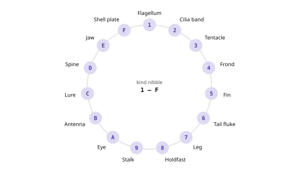

Low mutation rates keep lineages coherent long enough to be recognized as species. Deleted parts and unused genes keep changing quietly; a later mutation can bring them back into use.

**Diet shifts** exist because mixed diets are worse than both pure ones (see *Feeding*). A lineage moving from one way of feeding to another would otherwise have to pass through a worse mix. A shift jumps across it.

# Species

## Founding a species

Every organism carries a species, inherited from its parent. When an offspring is born with a mutation, its genome is compared with the **founder genome** of its parent's species. If the difference exceeds the species threshold, the offspring founds a new species, which records its parent species and the time.

The difference between two genomes is a weighted average of the differences of each gene, each measured from 0 to 1:

- Each gene counts at most 0.3, so one large jump in a single gene can't make a new species.
- Color genes weigh 0.25. Part size and place bytes weigh 0.3, and count only when both genomes have a part in that slot.
- A part type counts 0.5 if the kind differs, or a fraction of that if only the symmetry differs.
- Every other gene weighs 1.

The weights add up to 46.55. The species threshold is 0.035, so a new species needs a total weighted difference of about 1.6: for example six genes each changed by `4D` or more, or about twenty genes each changed by `14`.

A new **genus** is founded the same way, at a threshold of 0.07 from the genus's founder.

## Established species and extinction

A new species is **established** once it reaches 20 living members. Only then is it named, listed and charted. Species that die out before that are forgotten. When the last member of an established species dies, it goes **extinct**. The species list, the charts and the family tree record founding times, parent species, peak populations and extinctions.

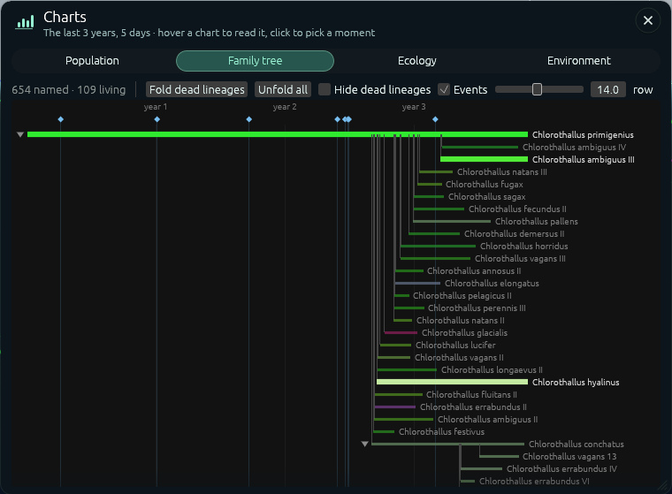

## Names

Species get two-part Latin-style names, built from what the organism is like.

**Genus** = prefix + diet root + size ending.

- The **prefix** is the body's most striking feature: *Acantho-* (spines), *Cirro-* (tentacles), *Ommato-* (eyes), *Pyro-* (heat-loving), *Macro-* (large), *Arthro-* (segmented), *Phyllo-* (fronds), and so on. If nothing stands out, the prefix is the color: *Chloro-* (green), *Rubro-* (red), *Cyano-* (blue) and others.
- The **diet root** comes from the main diet: *-phyta*, *-coccus*, *-thallus* for photosynthesizers; *-thermus*, *-lithus*, *-bacter* for chemosynthesizers; *-sapros*, *-phagus*, *-lysis* for scavengers; *-vorax*, *-odon*, *-raptor* for hunters. A new genus keeps its parent genus's root while it eats the same way, so related genera sound related.
- The **ending** depends on adult size: small (*-ella*, *-ula*, *-idium*), medium (*-ops*, *-ia*, *-ides*), or large (*-us*, *-on*, *-otherium*).

**Epithet.** A starting species (the ancestor, and the vent ancestor if there is one) gets *primigenius*, *primordialis*, *pristinus* or *archaeus*. Any other species is named for what sets it apart from the named species it split from: gaining eyes gives *oculatus*, losing them *caecus*; growing spines *spinosus*; becoming toxic *toxicus*. What it is outright counts a little too. Words that repeat the genus prefix are avoided, and each feature has several synonyms so sister species differ. When nothing stands out, color and pattern words are used (*viridis*, *maculatus*), then about 100 neutral words (*vulgaris*, *placidus*), then roman numerals.

A genus name describes the genus's founding genome, and an epithet describes the species' founding genome. Lineages keep evolving after they are named, so a name records where a lineage started. *Phylloplasmidium calidus* was founded by a small (*-idium*) photosynthesizer (*-plasma*) whose fronds stood out (*Phyllo-*) and which preferred warmer water than the species it split from (*calidus*). In the world shown in the figures, its members at the shelf vent now live mostly on minerals and marine snow.

# Events

| Event | How often | What happens |
|---|---|---|
| Day and night, seasons | A day is 10 min; each season is 15 min (1.5 days), so a year of four is 1 hour | Light and temperature rise and fall. Reserves and strategies that last the night pay off. |
| Climate drift | Days | Global temperature wanders up to ±8 °C |
| Vent lifecycle | Hours | Temporary vents open, flare, fade and die |
| Upwelling | About every 1.5 hours | For 30 minutes, minerals and nutrients well up into the top 600 units over a band 1,500 units wide. Blooms follow. |
| Plague | About every 8 hours | Strikes the most common species, but only if it makes up at least 35% of all organisms. For 10 minutes each member has a 0.2% chance per second of dying (about 70% die in total). No single species can take over the world for long. |
| Rock wall | About every 30 hours | A wall 200 units wide rises from the seafloor to the surface over 6 minutes, splits the ocean in two for 20 hours, then sinks. Populations on either side evolve apart, then meet again. |
| Meteor impact | About every 48 hours | Kills everything within 700 units of the impact near the surface, releases minerals, and dims the sun by up to 70% for 4 days, clearing slowly |

Events are random; the times above are averages. Ctrl+1–4 triggers a plague, upwelling, meteor or rock wall immediately, and Acts of God (see *Observing the World*) lets you aim them.

**Extinction is final.** If every organism dies, nothing is reseeded. The world goes on empty and the log records: "The last species has gone extinct. Life has ceased in this world."

# Observing the World

## The inspector

Clicking an organism opens the inspector and follows it. Its four tabs show:

- **Overview**: vitals (energy, HP, age), what it is doing now, and its diet.
- **Body**: its shape, each part in plain language, and the abilities they add up to.
- **Chemistry**: how it breathes, what it takes from and gives to the water, and the water around it.
- **Genome**: every gene with its value and meaning.

"Record in Field Notebook" sketches the organism under its species in the field notebook (key N).

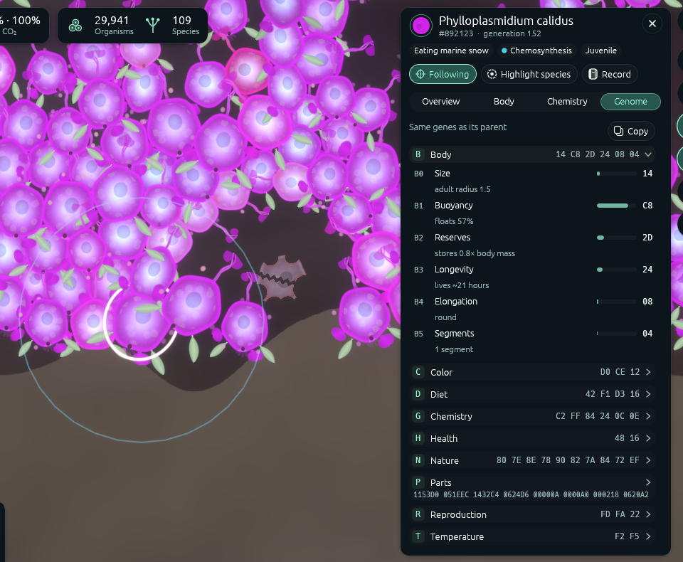

Right-clicking the water opens the water inspector for that spot: light, temperature and the amount of every substance.

## Acts of God

The lightning-bolt button at the bottom of the right-hand toolbar opens Acts of God: tools that change the world where you point. Pick a tool, then click in the world. The cursor becomes a crosshair, the area the act will reach is outlined, and a label beside the cursor says what a click will do. Escape, or clicking the tool again, puts it down.

| Tool | What it does |
|---|---|
| Move | Drag an organism to move it. To move several, drag a box around them (hold Shift to start the box on an organism), then drag any of them. Click empty water to let go. |
| Kill | Click an organism to kill it, or drag a box to kill everything in it. They leave carcasses as usual. |
| Plague | Click an organism: the named species it belongs to falls sick for 10 minutes, whatever its share of all life. |
| Upwelling | Minerals and nutrients well up to the surface around where you click, for 30 minutes. |
| Meteor | Strikes where you click: everything within 700 units dies, minerals are released, and the sun dims for 4 days. |
| Rock wall | A wall rises from the seafloor where you click, stands for 20 hours, then sinks. |
| Heat wave | The water within 1,500 units either side of where you click warms by up to 6 °C for 30 minutes: fully at the surface, less with depth (about a third as much 700 units down). It builds up and dies away gradually. |
| Cold snap | The same, but the water cools by up to 6 °C. |
| Storm | For 20 minutes, fast eddies churn the top 500 units of water within 1,250 units either side of where you click, tossing organisms and carcasses about. The storm also stirs the upper water, evening it out with the water below it, which brings nutrients up to the surface. |
| Sea level | The sea falls by the *Drop* amount (50 to 3,000 units) over 5 minutes, stays low for 2 hours, then rises back over 5 minutes. Swimmers are carried down with the surface. Anything left out of the water drops until it reaches water or rock, and can't breathe there: it suffocates like an aerobe in a dead zone. Drained water loses what it held, and the returning sea refills it with ordinary seawater. Vents left above the water still smoke but release nothing: no minerals, CO₂, nutrients or heat. |
| Pour into the water | Pick a substance (nutrients, minerals, oxygen, CO₂, toxin or marine snow), then click to pour a dose of it into the water around the click. A dose is about what five small organisms need to grow up and breed: 30 energy of minerals or marine snow, 10 nutrients, or 60 oxygen or CO₂. *Radius* sets how far it spreads, from 20 to 800 units, without changing the amount; click again to pour more. Poured toxin carries no species' colour, so it harms every organism. |

Heat waves, cold snaps, storms and sea-level changes only happen as Acts of God. Events started this way otherwise behave like random ones. Every event going on is listed in the *Now* bar under the weather; hovering one shows an X that ends it at once.

## Controls

| Input | Action |
|---|---|
| Drag, WASD, arrow keys | Pan |
| Scroll | Zoom toward the cursor |
| Home | Show the whole world |
| Click | Inspect and follow an organism (F toggles following, Esc clears) |
| Right-click | Inspect the water |
| Space | Pause and resume |
| 1–7, + and − | Speed, from ½× to 64× |
| Tab | Hide the interface |
| C | Automatic camera |
| L | Species list |
| G | Charts and family tree |
| E | Event history |
| T | Event ticker |
| H | Help |
| N | Field notebook |
| M | Chemistry map: oxygen, CO₂, nutrients, minerals, toxin |
| F5 | Quicksave |
| Ctrl+1–4 | Plague, upwelling, meteor, rock wall |
| Bolt button | Acts of God (see above); Esc puts a tool down |
